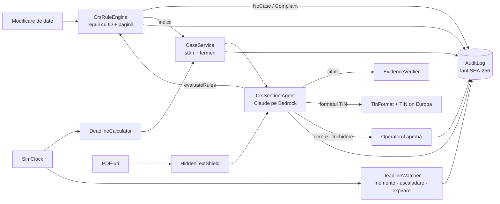

# CRS Sentinel

**Fiecare modificare de date a unui client devine o decizie CRS/FATCA, înainte să expire termenul legal.**

Când un client își schimbă adresa, telefonul, un ordin permanent sau o împuternicire, banca trebuie să afle din nou unde
plătește taxe clientul. Altfel îl raportează greșit la ANAF, pe fiecare cont. CRS Sentinel prinde schimbarea, aplică
regulile din Ghidul ANAF DAC2/CRS/FATCA **în cod** (fiecare regulă cu ID și pagină), pornește termenul, adună dovezile,
scrie cererea către client și urmărește răspunsul până la închiderea cazului, cu dovada confirmării.

**Codul decide, AI-ul explică, omul aprobă.**

Raiffeisen Bank, challenge-ul *AI for Operational Efficiency*, NEXXT AI Hackathon (VibeHack), 28–29 octombrie 2026.

| | |
| --- | --- |
| Aplicația | <https://hackathon-starter-k0ym.onrender.com/> |
| Video (≤ 3 min) | de completat la predare |
| Planul complet | [`docs/PLAN.md`](docs/PLAN.md) |
| Cum funcționează, cap-coadă | [`docs/CUM-FUNCTIONEAZA.md`](docs/CUM-FUNCTIONEAZA.md) |

---

## 1. Problema

Clientul declară într-o **autocertificare** în ce state e rezident fiscal și TIN-ul pentru fiecare. Când banca „știe sau
are motive să știe” că situația s-a schimbat, autocertificarea își pierde valabilitatea. Pe un cont nou, banca are
**90 de zile** să obțină o autocertificare nouă sau o explicație rezonabilă; altfel clientul e tratat ca rezident fiscal
**și** în jurisdicția inițială, **și** în cea nouă (Ghid ANAF, p. 35–36).

Azi, verificarea înseamnă un om care compară câmpuri, caută prin documente, scrie clientului și ține minte un termen.
CRS Sentinel face partea repetitivă; omul aprobă ce pleacă și ce se închide.

**Sursa de adevăr:** Ghidul ANAF DAC2/CRS/FATCA, varianta 29.12.2025, în [`docs/ghid/`](docs/ghid/) (PDF-ul și paginile
extrase, `pagini/p-XXX.md`). Regulile verificate pe textul ghidului: [`docs/reguli-verificate.md`](docs/reguli-verificate.md).

## 2. Cine ce face

| Cine | Ce face | Ce nu face niciodată |
| --- | --- | --- |
| **Codul** (determinist, testat) | Aplică regulile din ghid (ID + pagină), calculează termenele, verifică citatele, verifică formatul TIN, ține jurnalul | Nu ghicește: aceeași intrare dă mereu același rezultat |
| **AI-ul** (Claude pe Amazon Bedrock) | Citește documentele, extrage citate, găsește semnale de context, scrie textul către client, explică | Nu decide dacă ceva e indiciu, nu calculează termene, nu pornește alerte |
| **Omul** (operator, departamentul fiscal) | Aprobă cererea către client și închiderea cazului, decide cazurile la limită | — |

Un **semnal de context** (de exemplu, un salariu de la o firmă germană) se arată cu dovada lui, dar nu schimbă decizia și
nu deschide niciun caz. Naționalitatea nu e semnal; doar cetățenia SUA contează, și doar pentru FATCA.

## 3. Cum funcționează: cazul Mariei

Maria are un cont nou (deschis după 1 ian. 2016) și se mută la München.

```text
 [1] Modificarea intră (ChangeEvent): adresă nouă în DE                         jurnal: change.received
 [2] CrsRuleEngine compară „înainte” cu „după” (cod pur, fără AI)
       CRS-IND-ADDR  (DE)  p. 29 lit. b   indiciu
       CRS-IND-PHONE (DE)  p. 29 lit. c   indiciu: telefon DE și niciun telefon RO
       capcanele verificate și respinse, fiecare cu explicație
       → Clarification                                                         jurnal: rule.applied ×2
 [3] CaseService deschide cazul: termen = data aflării + 90 de zile, memento la ziua 85   jurnal: case.opened
 [4] Agentul pregătește cazul
       readDocument   → doar textul vizibil, după scut
       recordEvidence → codul verifică citatul în pagină
       recordSignal   → „salariu de la Müller GmbH”: semnal, fără alertă
       draftClientRequest → lista de documente vine din cod, textul îl scrie modelul
 [5] sendClientRequest: cere APROBAREA operatorului                             jurnal: request.approved
 [6] Data simulată +85 de zile → memento și escaladare la departamentul fiscal
 [7] Răspunsul Mariei: autocertificare nouă (PDF)
       extractSelfCertification → jurisdicții și TIN, fiecare câmp cu citat verificat
       checkTin(DE)  → „format valid”
       evaluateRules → Compliant, raportabil pentru DE
 [8] closeCase: cere APROBAREA operatorului → dovada confirmării (canal, moment, hash)   jurnal: case.closed
 [9] /audit → „Verifică” lanțul de hash-uri; „Falsifică” pe o intrare arată exact intrarea ruptă
```

Fără răspuns, la ziua 91 cazul trece în `Expired`, cu consecința din ghid (rezidentă în RO și în DE). Diagrama completă,
cu toți participanții: [`docs/PLAN.md` §6.3](docs/PLAN.md#63-fluxul-mariei-traseul-din-video).

Acesta e traseul-țintă. Pe `main`, pașii 1–3 și 6 sunt cod cu teste (`ChangeService`, `CrsRuleEngine`, `CaseService`,
`DeadlineWatcher`), iar serviciile pentru dovezi, cerere, aprobare și închidere există în `CaseService`. Uneltele agentului
de la pașii 4, 5, 7 și 8 sunt pe `main` (#44, #47), cu mock-ul care le cheamă; o rulare pornește azi doar prin API, iar
aprobarea se dă pe `/runs/{id}`. Paginile cazului, ale schimbării noi și dashboard-ul CRS sunt pe `main` din #49, cu fluxul
manual al cazului (fără agent); starea exactă e în [§11](#11-stare).

### Capcanele (fără alarme false)

| Modificarea | Rezultatul | De ce |
| --- | --- | --- |
| Mutare Cluj → Iași | `NoCase`, explicat | Nicio regulă din p. 29–31 nu se aplică (interpretare de design, `GEN-DOMESTIC`) |
| Telefon german lângă telefonul românesc | `NoCase` | Regula CRS cere „niciun telefon în România” (p. 29 lit. c) |
| Ordin permanent către un IBAN german, din contul curent | `NoCase`, explicat | Ordinele din conturile de depozit sunt excluse la CRS (p. 29 lit. d) |
| Același ordin, din contul de custodie | `Clarification` | Excepția nu se aplică (p. 29 lit. d) |
| Ordin permanent către SUA, din contul curent | `FatcaAlert` | La FATCA excepția pentru depozite nu există (p. 31) |
| Telefon SUA, chiar lângă unul românesc | `FatcaAlert` | La FATCA orice telefon SUA e indiciu (p. 31) |
| Salariu de la o firmă germană | `NoCase` + semnal | Venitul nu e în lista de indicii |
| PDF cu text alb ascuns | `ShieldAlert` | Scutul scoate textul înainte să ajungă la model |

## 4. Regulile

Indiciile CRS sunt lista închisă din ghid, p. 29 (Legea 207/2015, Anexa 1, Secțiunea III, subsecțiunea B); cele FATCA
sunt din p. 31 (Acordul FATCA, Anexa I, Secțiunea II, paragraful B). Catalogul complet, cu ID-urile finale:
[`docs/PLAN.md` §8.2](docs/PLAN.md#82-catalogul-de-reguli-id-urile-sunt-finale-paginile-verificate-în-ghid-detalii-în-docsreguli-verificatemd).

| Grup | Reguli | Pagina |
| --- | --- | --- |
| Indicii CRS | `CRS-IND-RES`, `-ADDR`, `-MAIL`, `-PHONE`, `-SO`, `-POA`, `-CO` | 29 (lit. a–f), 48 |
| Indicii FATCA | `FATCA-IND-CIT`, `-POB`, `-ADDR`, `-PHONE`, `-SO`, `-POA`, `-CO` | 31 |
| Autocertificarea | `SC-VALID`, `SC-TIN-FORMAT`, `SC-TIN-MISSING`, `SC-CONSISTENT`, `FATCA-SC` | 34, 36–37, 53, 38 |
| Termene și expirare | `DL-NEW-90`, `DL-PRE-YEAR`, `DL-EXPIRED-NEW`, `DL-EXPIRED-PRE` | 20–21, 29, 35–36 |
| Răspunsul clientului | `RESP-EXPLANATION`: student cu viză, profesor sau stagiar, diplomat, funcționar UE | 37 |

**Deciziile** (precedența, de la cea mai puternică): `ShieldAlert` > `FatcaAlert` > `Clarification` > `Compliant` >
`NoCase`. `NoCase` = nicio regulă de indiciu nu s-a aplicat; `Compliant` = există indicii, dar toate sunt acoperite de
autocertificare sau de o explicație acceptată.

**Termenele** depind de contul nou sau preexistent, nu de produs. Statutul se calculează pe regim din data deschiderii:
CRS preexistent = existent la 31.12.2015, FATCA preexistent = existent la 30.06.2014 (p. 20).

| Cont | Termen | La expirare | Pagina |
| --- | --- | --- | --- |
| Nou | 90 de zile calendaristice de la data la care banca știe de schimbare | Rezident și în jurisdicția inițială, și în cea nouă | 20–21, 35–36 |
| Preexistent | Ultima zi a anului sau 90 de zile; implementăm cea mai târzie dintre ele | Rezident cel puțin în noua jurisdicție | 29 |

## 5. Interpretările de design (spuse deschis)

- **„Știe sau are motive să știe”.** Considerăm că datele pe care banca le are deja (adrese, telefoane, ordine permanente,
  împuterniciri) sunt cele pentru care banca știe sau are motive să știe că autocertificarea poate fi nesigură (p. 30, 35).
- **Indiciile la conturile noi.** În ghid, lista de indicii e procedura pentru conturile preexistente (p. 29, 31). Pentru
  conturile noi, ghidul cere autocertificarea și testul de rezonabilitate față de informațiile băncii (p. 33). Folosim
  indiciile drept criterii prin care autocertificarea e contrazisă.
- **Mutarea în țară** (`GEN-DOMESTIC`) nu are o pagină proprie: nicio regulă din p. 29–31 nu se aplică, deci `NoCase`.
- **Termenul la contul preexistent.** Ghidul (p. 29) spune „până în ultima zi a anului calendaristic în cauză [...], sau
  în 90 de zile calendaristice”, în paragraful despre testul adresei de rezidență (nota 57). Aplicăm cea mai târzie
  dintre cele două date. Pentru contul documentat prin adresa de rezidență așa scrie legea (Codul de procedură fiscală,
  Anexa nr. 2 pct. 1: „oricare dintre acestea este mai recentă”), care transpune Directiva 2011/16/UE, Anexa II pct. 1 (introdusă prin Directiva 2014/107/UE): „by the later of the last day of the relevant calendar year or other appropriate reporting period, or 90 calendar days following the notice or discovery of such change in circumstances”
  ([EUR-Lex](https://eur-lex.europa.eu/legal-content/EN/TXT/?uri=CELEX:32014L0107); citatul e verificat pe [copia legislation.gov.uk](https://www.legislation.gov.uk/eudr/2011/16/annex/II), 28.10.2026), și Comentariul OCDE la CRS (Secțiunea III, pct. 13). Directiva are aceeași limită: se aplică
  atunci când banca „has relied on the residence address test”.
  La indiciile din căutarea electronică legea spune doar „ori” (Anexa nr. 1, secțiunea III, subsecțiunea B, pct. 16),
  ghidul (p. 30) nu dă termen, iar Comentariul OCDE (pct. 16) spune „until the later of”. Sistemul nu știe prin ce
  procedură a fost documentat contul, deci aplică aceeași regulă și tratează toate cazurile ca indicii din căutarea
  electronică (de exemplu 17b): acolo e interpretarea noastră.
- **NEVERIFICAT:** la FATCA, ghidul (p. 38) nu dă un termen pentru schimbarea de circumstanțe: cazul se deschide fără
  termen din ghid, cu NEVERIFICAT afișat, și nu împrumutăm cele 90 de zile CRS.

## 6. Arhitectura



Săgețile agentului sunt ținta din [`docs/PLAN.md` §13](docs/PLAN.md#13-agentul-crs-sentinel). Pe `main`,
`CrsSentinelAgent` are 14 unelte (#44), iar mock-ul RO/EN e o mașină de stări pe starea cazului din baza de date, care
cheamă uneltele reale (§11).

- **Cod pur** (`Rules`, `Deadlines`, `Shield`, `Tin`, hashing-ul din `Audit`): fără EF, fără AI, fără HTTP. Primește un
  `ClientSnapshot` imutabil și întoarce un rezultat, deci se testează în milisecunde.
- **Servicii** (`ChangeService`, `CaseService`, `ClientService`, `EvaluationService`): validare, roluri, tranzacții, jurnal.
  Tranzițiile cazului sunt doar aici, fiecare cu verificare de rol și cu intrare în jurnal.
- **Agentul** e un agent cu unelte, orchestrat de cod, cu omul la decizie: nu atinge baza de date direct, iar cine
  deschide cazul, regulile și termenele sunt în cod. Runtime-ul cere aprobarea omului pentru uneltele marcate `needsApproval`
  și, după aprobare, le rulează fără model; așa sunt marcate `sendClientRequest` și `closeCase` (#44).
- **Data simulată** (`SimClock`) e un serviciu separat, cu decalaj setabil („+85 de zile”). Codul CRS nu citește ora din
  altă parte; restul aplicației rămâne pe ceasul real.
- Entitățile, interfețele și structura folderelor: [`docs/PLAN.md` §6–13](docs/PLAN.md#6-arhitectura).

### Încrederea

| Piesa | Ce garantează |
| --- | --- |
| `HiddenTextShield` (PdfPig, literă cu literă) | Textul alb, microscopic, din afara paginii sau invizibil e scos **înainte** să ajungă la model; documentul primește semnal roșu |
| `EvidenceVerifier` | Un citat există în textul vizibil al paginii indicate. Un citat inventat sau luat din textul ascuns apare „citat negăsit” |
| `TinFormat` + TIN on Europa | Formatul TIN pe țară (DE, IT, AT, ES, FR, US, RO); pentru statele UE, verificare la serviciul Comisiei Europene, care confirmă tot doar structura și sintaxa. Spunem „format valid”, niciodată „TIN valid” |
| `AuditLog` | Fiecare pas e o intrare cu `Hash = SHA-256(hash-ul anterior + conținut)`; „Verifică” găsește exact intrarea modificată |
| `PiiVault` | CNP, IBAN, card, e-mail și telefoane (românești și internaționale, cu `+` sau `00`) sunt mascate înainte de model; uneltele lucrează cu valorile reale; ce se salvează rămâne mascat |
| Verificări pe răspuns (`Features/Checks`) | `pii-leak` (fără date personale scăpate); în `CrsChecks`: `evidence-quoted` (citatele sunt printre rezultatele uneltelor), `signals-never-alert`, `rule-cited` (fiecare indiciu are regula și pagina), `no-tin-valid-claim`. Pe `main`, agentul CRS are active `pii-leak` și `evidence-quoted` (#44); celelalte trei sunt oprite, decizia R4 |

### Modelele și fallback-ul

- Amazon Bedrock, regiunea **us-west-2** (contul de workshop blochează Bedrock în `eu-central-1`), doar cu date sintetice.
  În producție: o regiune UE sau un model pe serverele băncii (endpoint compatibil OpenAI).
- Două profiluri: `extract` (Claude Haiku 5.5) pentru extrageri și clasificări mici; principal (Claude Sonnet 5.5) pentru
  agent și textul către client.
- **Lanțul care nu pică:** live → înregistrare (`Recordings/crs-sentinel.json`, încă neînregistrată) → mock. Mock-ul
  cheamă uneltele reale, deci aplicația merge și fără internet sau chei. Replay-ul **nu** rulează uneltele: îl folosim doar
  pentru întrebări care citesc (de exemplu „rezumă cazul”), niciodată pentru pași care schimbă date.

## 7. Domeniul MVP

**În MVP:** persoane fizice; schimbările de situație după onboarding (nucleul); validarea unei autocertificări noi (caz
secundar).

**Ce nu prindem încă:**

- conturile firmelor și persoanele care le controlează;
- fișierul F3000 și formularele W-8BEN;
- textul acoperit de o formă desenată peste el, în PDF; OCR pe scanări proaste;
- existența unui TIN (verificăm doar formatul);
- conturile preexistente cu valoare mare (peste 1.000.000 USD): acolo Comentariul OCDE (Secțiunea III, pct. 49, p. 125)
  vorbește doar de cele 90 de zile de la identificarea indiciului;
- integrarea reală cu sistemele băncii, ONRC sau ANAF.

## 8. Cazurile-etalon și metricile

Rezultatul corect e scris **înainte** de cod: 18 scenarii (cu variantele 5a–5c și 17a–17b), fiecare cu intrarea exactă,
decizia, regulile așteptate și pagina din ghid, în [`docs/GOLDEN-CASES.md`](docs/GOLDEN-CASES.md). Pe lângă ele, 50 de
clienți sintetici (același seed → aceleași date), etichetați după scenariul ales la generare, nu după rezultatul motorului.

Metricile vin doar din rulări reale (`/metrics` și testele), prezentate separat:

1. **Acoperirea specificației:** cazurile trec sau nu. Motorul e determinist, deci, când toate cazurile trec,
   spunem „regulile din ghid sunt implementate și testate”, nu „acuratețe 100%”.
2. **Unde există incertitudine:** extragerea din PDF câmp cu câmp, procentul de citate verificate și respinse, scutul pe
   PDF-uri variate, semnalele care ar fi schimbat decizia (0 prin construcție, verificat la fiecare rulare).
3. **Eficiența operațională:** timpul pe caz cu agentul, doar când se poate măsura dintr-o rulare. Azi `EvaluationService`
   îl raportează „indisponibil”: rulările agentului nu sunt legate de cazuri. Nu îl comparăm cu un timp manual: nu avem o
   estimare de la mentor.

### Ultima rulare

Rularea pe commit-ul `e0bc47c`, 28.10.2026, 22:08, **fără model** (nicio cheie, niciun apel AI): pagina `/metrics`, cu
aplicația pornită local, și `IEvaluationService.RunAsync()` chemat direct dau aceleași cifre. Pe `eaea3f3` (după #44, la
22:14), `IEvaluationService` dă din nou aceleași cifre. Toate cifrele de mai jos vin din cod determinist, nu din AI.

**1. Acoperirea specificației** (motorul `crs-rules/1.2`): regulile din ghid sunt implementate și testate, pe 20 de
cazuri-etalon cu date de intrare și pe 50 de clienți sintetici.

| Set | Evaluate | Trec | Acțiuni așteptate | Prinse | Ratate | Alarme false |
| --- | --- | --- | --- | --- | --- | --- |
| Cazurile-etalon | 20 (cazul 10 e la scut) | 20 | 13 | 13 | 0 | 0 |
| Clienții sintetici | 50 | 50 | 10 | 10 | 0 | 0 |

**2. Unde există incertitudine**

| Ce | Rezultat |
| --- | --- |
| Scutul, pe 12 PDF-uri generate | 4 cu text ascuns (5 texte: alb 1, microscopic 2, în afara paginii 1, invizibil 1): toate 5 detectate, 0 ratate; 8 curate, 0 alarme false |
| Citatele, pe banca de test a `EvidenceVerifier` (citate fixe, nu ale modelului) | 10 din 10 citate adevărate verificate; 4 din 4 citate doar din textul ascuns respinse; 38 din 38 de citate inventate respinse |
| Extragerea autocertificării de către AI | nemăsurată: nu există încă o rulare live |
| Semnalele care ar fi schimbat decizia | 0, prin construcție (motorul nu primește semnale), verificat la rulare |

**3. Eficiența operațională:** nemăsurată. Timpul agentului pe caz nu se poate măsura încă, iar timpul manual nu are sursă.

Nicio cifră fără rulare: la fiecare rulare nouă, tabelul se refă cu commit-ul, data și modul.

## 9. Confidențialitate

- **Doar date sintetice.** Clienții, documentele și TIN-urile sunt generate; actele de identitate poartă „SPECIMEN”.
- **Temeiul legal** este obligația legală (art. 6 alin. (1) lit. (c) GDPR). Codul de procedură fiscală (Legea 207/2015)
  cere băncii să aplice procedurile de diligență fiscală din anexele nr. 1 și 2 (art. 291 alin. (4)) și să raporteze
  anual conturile la ANAF (art. 62 alin. (1)); pentru FATCA, procedurile din Acordul FATCA (art. 62 alin. (3), Legea
  233/2015). Citatele sunt în [`docs/PRIVACY-TEXT.md`](docs/PRIVACY-TEXT.md#7-surse).
- **Păstrarea:** rulările agentului se șterg automat după `Privacy:RetentionDays` (implicit 30 de zile). Nicio regulă
  de retenție nu șterge clienții, cazurile sau jurnalul. Legea cere băncii să păstreze înregistrările de diligență
  fiscală și de raportare, și probele pe care s-a bazat, 10 ani de la termenul de raportare de 15 mai
  (art. 62 alin. (11)).
- **Art. 22 GDPR nu se aplică:** nicio decizie nu se ia exclusiv automat. Codul aplică regulile, omul aprobă cererea și
  închiderea.
- **Mascarea** CNP-urilor, IBAN-urilor, numerelor de card, e-mailurilor și telefoanelor (românești și internaționale, cu `+` sau `00`) înainte de model ține
  de reducerea la minimum a datelor (art. 5 alin. (1) lit. (c) GDPR) și de securitatea prelucrării, prin pseudonimizare
  și criptare (art. 32 alin. (1) lit. (a) GDPR).
- Numele, adresele, datele de naștere și TIN-urile străine nu sunt mascate înainte de model (datele
  sunt sintetice). Pagina `/privacy` arată, din configurația live, ce ajunge la care model, ce se salvează și cât timp.

## 10. Pornire rapidă

```bash
tools/setup-dev.sh                              # o singură dată: .NET 10, build, Chromium pentru testele E2E
dotnet run --project src/HackathonStarter       # http://localhost:5000, merge pe mock fără nicio cheie
dotnet test tests/HackathonStarter.Tests        # teste unitare, fără rețea
dotnet test tests/HackathonStarter.E2E          # teste în browser; pornesc singure aplicația
```

Pe macOS, pasul Chromium din `tools/setup-dev.sh` pică (scriptul cheamă driverul `linux-x64`). După build, rulează:
`tests/HackathonStarter.E2E/bin/Debug/net10.0/.playwright/node/darwin-arm64/node tests/HackathonStarter.E2E/bin/Debug/net10.0/.playwright/package/cli.js install chromium` (pe Mac cu Intel: `darwin-x64`).

Sau deschide `HackathonStarter.slnx` în Visual Studio, Rider sau VS Code și pornește proiectul `HackathonStarter`.
Baza de date SQLite se creează la pornire, cu datele demo. Utilizatori demo (meniul din bara de sus): Ana (operator,
admin), Mihai (departamentul fiscal, member), Vera (viewer, nu poate aproba).

**Bedrock live (opțional):** credențialele vin doar din lanțul implicit AWS (variabile de mediu, profil local sau rol
IAM), niciodată din repo. În `appsettings.Local.json` (ignorat de git): `"AI": { "Provider": "Bedrock", "Region":
"us-west-2", ... }`, după exemplul din `appsettings.Local.example.json`.

**Deploy:** Render, din `render.yaml` și `Dockerfile`; `main` se publică doar după ce CI-ul e verde
([`docs/DEPLOY.md`](docs/DEPLOY.md)).

## 11. Stare

Lucrăm în paralel, pe module; fiecare PR intră doar cu CI verde (build cu 0 warnings, teste unitare și E2E).

Starea de pe `main` la commit-ul `46e6c81`, verificată în cod pe 28.10.2026, la 23:15: `dotnet build -warnaserror` fără
warnings, testele unitare 1254 din 1254, E2E 30 din 30 (CI-ul de pe `main`).

| Modul | Rol | Pe `main` | În lucru | Lipsește |
| --- | --- | --- | --- | --- |
| Documentația: planul, regulile verificate, paginile ghidului, cazurile-etalon, sursele, scenariul video, textul `/privacy` | toți | da (#1–#4, #6, #7, #10, #12, #14, #15, #19, #30, #33, #34) | | |
| Contractele și entitățile (Faza 0), `SimClock` | integrator | da (#13, #18) | | |
| `CrsRuleEngine`, `RuleCatalog`, `GoldenEngineTests` | R1 | da (#16, #37, #41) | | |
| `ChangeService`, `CaseService` (stările cazului), `DeadlineCalculator`, `DeadlineWatcher`, `SimClockControl`, cazurile de flux cap-coadă, resetarea demo-ului | R2 | da (#28, #40, #43; meniul „Demo” cu data simulată în #49) | | |
| `HiddenTextShield`, `EvidenceVerifier`, `TinFormat` + TIN on Europa, `AuditLog`; scanarea unui document nescanat din pagina clientului | R3 | da (#23, #48) | | |
| Pagina `/privacy` (jurnal, TIN on Europa, Bedrock, retenție, temeiul legal) | R3 | da (#26) | | |
| Provider Bedrock | R4 | da (#5) | | |
| Runtime-ul agentului (aprobarea oprește rularea), verificările CRS pe răspuns, mascarea telefoanelor străine | R4 | da (#20, #35) | | |
| `CrsSentinelAgent`: cele 14 unelte, system prompt-ul, mock RO/EN (Maria cap-coadă), verificările active; mock-ul scrie doar la cele două acțiuni ale cazului (mesajele fixe din `SentinelActions`) | R4 | da (#44, #47) | | înregistrarea `Recordings/crs-sentinel.json`; butoanele „Analizează dosarul” și „Verifică răspunsul” pe pagina cazului (nu sunt pe `main`); pasul din UI care pune autocertificarea Mariei în dosar |
| Datele: 50 de clienți sintetici, PDF-urile cazurilor-etalon, cazurile-etalon transcrise, seed-ul | R5 | da (#8, #9, #11, #17, #21, #22, #25, #27, #31, #36, #39) | | |
| `EvaluationService` (cele trei feluri de cifre) și pagina `/metrics` | R5 | da (#29, #38, #42) | | |
| Pagina clientului `/clients`, `/clients/{code}` (adrese, conturi, ordine permanente, autocertificări, documente, cazuri) | R5 | da (#45) | | |
| Paginile CRS: `/dashboard`, `/cases`, `/cases/{code}` (ceasul termenului, cererea, răspunsul, închiderea cu aprobare), `/changes/new`, meniul „Demo” | UI | da (#49) | | |
| README-ul și pitch-ul la zi cu `main` | R5 | | #46 | |
| Landing-ul și subsolurile | R5 | da (#24, #32) | | |

**Paginile CRS, așa cum sunt acum pe `main`:**

| Pagina | Ce arată |
| --- | --- |
| `/audit` | Lanțul de hash-uri, „Verifică” (toți) și „Falsifică” („Tamper” în EN, doar admin). La pornire are intrările istoricului din seed (#39) |
| `/metrics` | Cele trei feluri de cifre din `EvaluationService`, cu „Rulează din nou”, caz cu caz (§8) |
| `/privacy` | Textul actualizat (#26) |
| `/clients`, `/clients/{code}` | Lista clienților și fișa clientului (#45). Documentele nescanate au „Înregistrează încărcarea și scanează” (admin, member): extrasul lui Victor ridică semnalul roșu al scutului, cu fragmentul scos (#48) |
| `/changes/new` | Înregistrează o schimbare (sau un caz-etalon din meniul „Demo”) și arată pe loc verdictul motorului de reguli (#49) |
| `/cases`, `/cases/{code}` | Coada cazurilor și fișa cazului: indiciile cu regula și pagina, semnalele, dovezile, corespondența, jurnalul cazului și pasul următor, manual: ciorna cererii, „Aprobă și trimite”, „Înregistrează răspunsul”, „Aprobă închiderea”. Meniul „Demo” are „La ziua mementoului” și „Completează răspunsul-exemplu” (#49) |
| `/runs`, `/runs/{id}` | Rulările agenților, cu pașii și „Aprobă” / „Respinge”; aici se aprobă azi rulările `crs-sentinel` pornite prin API |
| `/settings` | „Resetează datele demo” (admin) readuce datele CRS, jurnalul și data simulată la starea de la pornire (#43) |
| `/dashboard` | Cazurile CRS: deschise, cu termen în 7 zile, în așteptarea aprobării, escaladate; următoarele termene (#49) |

## 12. Documentația

| Document | Ce conține |
| --- | --- |
| [`docs/PLAN.md`](docs/PLAN.md) | Planul de implementare: domeniul, modelul de date, regulile, arhitectura, rolurile, programul |
| [`docs/CUM-FUNCTIONEAZA.md`](docs/CUM-FUNCTIONEAZA.md) | Sistemul cap-coadă, pe înțelesul oricui din echipă |
| [`docs/reguli-verificate.md`](docs/reguli-verificate.md) | Fiecare regulă, verificată pe textul ghidului, cu pagina |
| [`docs/GOLDEN-CASES.md`](docs/GOLDEN-CASES.md) | Datele exacte ale cazurilor-etalon |
| [`docs/RESEARCH-CRS.md`](docs/RESEARCH-CRS.md) | Faptele din ghid și întrebările pentru mentor |
| [`docs/PITCH.md`](docs/PITCH.md), [`docs/SUBMISSION.md`](docs/SUBMISSION.md) | Scenariul video și checklist-ul de predare |
| [`docs/ui/macheta-caz.html`](docs/ui/macheta-caz.html) | Macheta paginii cazului |
| [`AGENTS.md`](AGENTS.md) | Convențiile de cod, pentru oameni și pentru asistenții AI |
| [`docs/TEMPLATE.md`](docs/TEMPLATE.md) | Referința template-ului: runtime-ul de agenți, configurarea, API-ul HTTP, comenzile |

## 13. Template-ul

Am pornit de la template-ul .NET al echipei, scris înainte de hackathon (commit-ul `381d8c2` din istoricul repo-ului):
.NET 10, Blazor Server, MudBlazor, EF Core, Microsoft.Extensions.AI. De acolo vin runtime-ul de agenți (unelte, aprobări,
rulări în fundal, înregistrări, mock), mascarea datelor personale, verificările deterministe, `TargetClient`, datele
sintetice, PWA-ul și pipeline-ul de deploy. Tot ce ține de CRS e scris în timpul hackathonului, începând cu 28 octombrie
2026. [Rulebook-ul](https://nexxtsummit.com/rulebook) nu interzice codul scris înainte și cere doar ca lucrul pe temă să
înceapă la startul oficial (28 oct., 09:00); organizatorii au confirmat pe 28 oct. Documentația template-ului:
[`docs/TEMPLATE.md`](docs/TEMPLATE.md).
