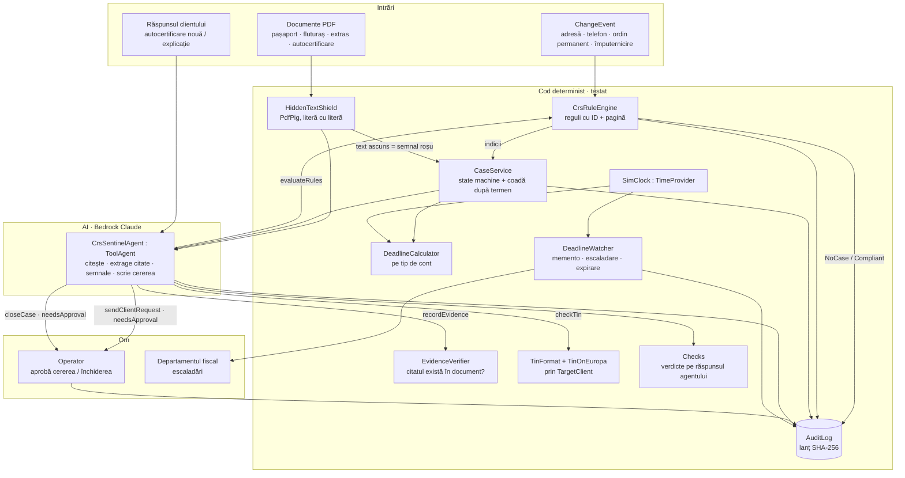
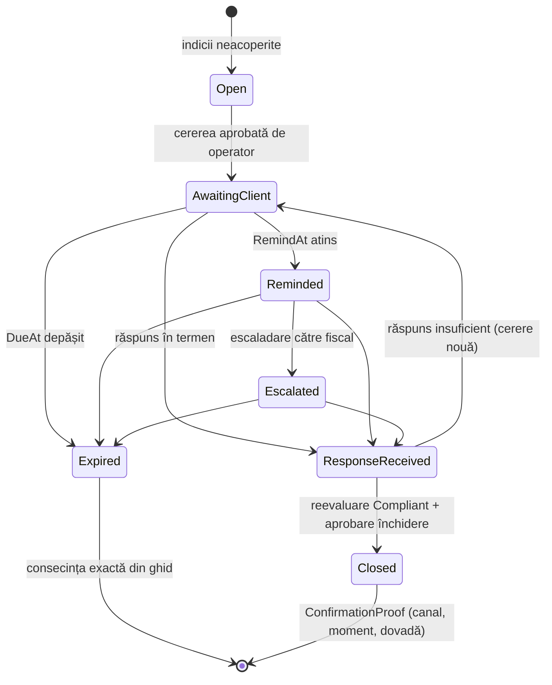
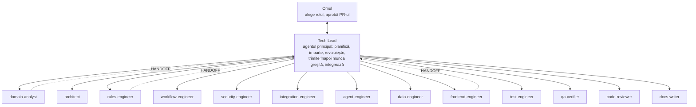
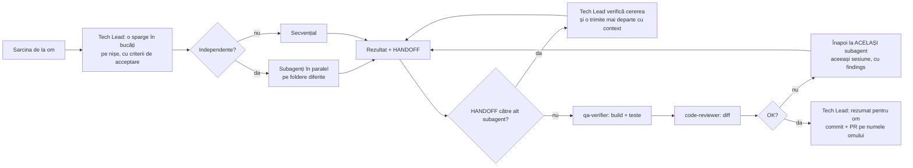

# CRS Sentinel: planul de implementare

> NEXXT AI Hackathon 2026 · Raiffeisen Bank · **AI for Operational Efficiency**
> Predare: **joi, 29 oct. 2026, ora 11:00** (noi: 10:30). Code freeze: **joi, 08:00**.
> Documentul de context pentru toată echipa și pentru agenții AI ai fiecăruia. Citește-l o dată cap-coadă,
> apoi doar secțiunea rolului tău. Ce e marcat **NEVERIFICAT** nu intră în cod final sau în pitch
> până nu are pagina din Ghidul ANAF.

---

## Cuprins

1. [Pe scurt](#1-pe-scurt)
2. [Tema și cum o acoperim](#2-tema-și-cum-o-acoperim)
3. [Domeniul, pe înțelesul unui developer](#3-domeniul-pe-înțelesul-unui-developer)
4. [Ce intră în MVP și ce nu](#4-ce-intră-în-mvp-și-ce-nu)
5. [Stack-ul](#5-stack-ul)
6. [Arhitectura](#6-arhitectura)
7. [Modelul de date](#7-modelul-de-date)
8. [Motorul de reguli](#8-motorul-de-reguli)
9. [Termene, cazuri și data simulată](#9-termene-cazuri-și-data-simulată)
10. [Scutul și dovezile](#10-scutul-și-dovezile)
11. [Verificarea TIN](#11-verificarea-tin)
12. [Jurnalul cu lanț de hash-uri](#12-jurnalul-cu-lanț-de-hash-uri)
13. [Agentul CRS Sentinel](#13-agentul-crs-sentinel)
14. [Modelele AI și fallback-ul](#14-modelele-ai-și-fallback-ul)
15. [Interfața (la final, împreună)](#15-interfața-la-final-împreună)
16. [Teste, cazuri-etalon și metrici](#16-teste-cazuri-etalon-și-metrici)
17. [Confidențialitate și GDPR](#17-confidențialitate-și-gdpr)
18. [Găzduire și deploy](#18-găzduire-și-deploy)
19. [Organizarea echipei: 5 roluri](#19-organizarea-echipei-5-roluri)
20. [Faza 0: PR-ul de contracte](#20-faza-0-pr-ul-de-contracte)
21. [Programul](#21-programul)
22. [Cum lucrăm cu AI: subagenți și Tech Lead](#22-cum-lucrăm-cu-ai-subagenți-și-tech-lead)
23. [Riscuri](#23-riscuri)
24. [Ce nu spunem și ce mai verificăm](#24-ce-nu-spunem-și-ce-mai-verificăm)
25. [Checklist de predare](#25-checklist-de-predare)
26. [Decizii deschise](#26-decizii-deschise)

---

## 1. Pe scurt

**CRS Sentinel transformă fiecare modificare de date a unui client într-o decizie CRS/FATCA, înainte să expire
termenul legal.** Când un client își schimbă adresa, telefonul, un ordin permanent sau o împuternicire, banca
trebuie să afle din nou unde plătește taxe clientul. Altfel îl raportează greșit la ANAF, pe fiecare cont.

Agentul prinde schimbarea, **codul** decide dacă e relevantă fiscal și pornește termenul, **AI-ul** adună
dovezile și scrie cererea către client, **omul** aprobă. Fiecare pas intră într-un jurnal care nu poate fi
modificat fără să se vadă.

**Trei principii, nenegociabile:**

| Cine | Ce face | Ce NU face niciodată |
| --- | --- | --- |
| **Codul** (determinist, testat) | Aplică regulile din ghid (cu ID și pagină), calculează termenele, verifică citatele, verifică formatul TIN, ține jurnalul | Nu „ghicește”; aceeași intrare dă mereu același rezultat |
| **AI-ul** (LLM) | Citește documente, extrage citate, găsește semnale contextuale, scrie text pentru client, explică | Nu decide dacă e indiciu, nu calculează termene, nu pornește alerte |
| **Omul** (operator / departament fiscal) | Aprobă cererea către client, aprobă închiderea, decide cazurile la limită | — |

---

## 2. Tema și cum o acoperim

**Enunțul Raiffeisen:** *Build an AI agent that handles repetitive internal banking work involving documents,
data, and predefined rules.* **De demonstrat:** *a working process that takes an input, applies the relevant
rules, and produces an outcome or flags an exception.* **Date:** sintetice.

| Cerința din slide | La noi |
| --- | --- |
| Input | O modificare de date a clientului (`ChangeEvent`) + documentele lui (PDF) |
| Applies the relevant rules | `CrsRuleEngine`: reguli din Ghidul ANAF DAC2/CRS/FATCA (29.12.2025), fiecare cu ID și pagină |
| Produces an outcome | `NoCase` (cu explicație), `Compliant`, caz deschis cu termen, caz închis cu dovada confirmării |
| Flags an exception | `Clarification`, `FatcaAlert`, semnal roșu de la scut, memento/escaladare, termen expirat |
| Reconcile records / discrepancies | Datele băncii (adrese, telefoane, ordine, împuterniciri) vs autocertificarea |
| Validate applications against requirements | Autocertificarea nouă: TIN (format), motiv lipsă TIN, consistență cu indiciile |
| Triage and summarise requests | Coada de cazuri ordonată după termen; rezumatul cazului |
| Detect anomalies | Scutul pentru text ascuns; semnale contextuale (fără alertă) |
| Synthetic data | 18 cazuri-etalon + 50 de clienți sintetici, PDF-uri sintetice (`SyntheticData`) |

---

## 3. Domeniul, pe înțelesul unui developer

> Sursa de adevăr: **Ghidul ANAF DAC2/CRS/FATCA, varianta 29.12.2025**, în `docs/ghid/` (PDF + pagini extrase
> în `docs/ghid/pagini/p-XXX.md`). Orice regulă din cod citează pagina. Dacă nu găsești pagina, regula e
> marcată `GuidePage = "?"` și un test o semnalează înainte de freeze.

| Termen | Ce înseamnă pentru noi |
| --- | --- |
| **CRS** (Common Reporting Standard), **DAC2** | Regimul OCDE/UE: banca raportează la ANAF conturile clienților rezidenți fiscal în **alte state** participante; ANAF trimite mai departe. |
| **FATCA** | Regimul SUA: banca raportează conturile „US persons” (cetățeni / rezidenți SUA). Indiciile sunt puțin diferite (ex. locul nașterii în SUA, orice telefon SUA). |
| **Autocertificare** (self-certification) | Declarația clientului: în ce state e rezident fiscal + TIN pentru fiecare (sau motivul lipsei TIN). |
| **Jurisdicție raportabilă** | Un stat față de care România raportează CRS (DE, IT, AT, ES…). România însăși **nu** e raportabilă pentru un rezident RO. NEVERIFICAT lista în ghid / anexă. |
| **Indiciu** (indicium) | Un fapt din datele băncii care arată posibilă rezidență într-o jurisdicție raportabilă (lista e **închisă**, în lege). Doar indiciile pot porni o acțiune. |
| **Semnal contextual** | Ceva găsit de AI în documente care **nu** e indiciu legal (ex. salariu de la o firmă germană). Se afișează, cu dovadă, dar **nu pornește niciodată** o alertă. |
| **Schimbare de circumstanțe** | Orice modificare care adaugă informații relevante despre client sau contrazice situația lui, inclusiv la conturile asociate (ghid, p. 30). Face autocertificarea posibil incorectă sau nesigură (p. 29, p. 35). Termenul pornește de când banca află, nu de la data schimbării. |
| **Termen** | **90 de zile calendaristice** (ghid, p. 29, p. 35–36). Cont nou: de la data la care banca „cunoaște sau are motive să cunoască” schimbarea (p. 35–36). Cont preexistent: „de la notificarea sau descoperirea” schimbării, sau „până în ultima zi a anului calendaristic” (p. 29). Nu curge de la data schimbării. NEVERIFICAT: dacă ziua 0 se numără, ce variantă se aplică la preexistent, termenul FATCA (p. 38 nu dă unul). Detalii în 9.2. |
| **Explicație rezonabilă** | Clientul arată, cu documente dacă e cazul, că declarația inițială rămâne valabilă (ghid, p. 35, lit. b). La schimbarea de circumstanțe, ghidul o admite doar la contul CRS nou; la preexistent (p. 29) și la FATCA (p. 38) cere declarație nouă. Exemplele de la p. 37 nu sunt o listă închisă („Exemple ... includ”): student, profesor sau stagiar (cu viza corespunzătoare „dacă este cazul”), diplomat, funcționar UE. Ele sunt date pentru testul de rezonabilitate; folosirea lor la o schimbare de circumstanțe e inferența noastră (NEVERIFICAT). |
| **Consecința la expirare** | CRS, cont nou: rezident în jurisdicția declarată inițial **și** în cea în care ar putea fi rezident după schimbare (ghid, p. 36). CRS, cont preexistent: căutare în evidența electronică, rezident cel puțin în statul nou (p. 29–30, Exemplul 2). FATCA: banca „va trata contul drept cont raportabil din Statele Unite” (p. 38). |
| **Cont de depozit** (depository account) | Cont curent, de economii, depozit. **Ordinul permanent dintr-un cont de depozit nu e indiciu CRS** (ghid, p. 29). Capcana noastră principală. |
| **Cont de custodie** (custodial account) | Cont de instrumente financiare. Aici ordinul permanent către străinătate **este** indiciu. |
| **Cont preexistent / nou** | CRS: preexistent = administrat la 31 decembrie 2015; nou = deschis la 1 ianuarie 2016 sau după (ghid, p. 20; pentru conturile care devin conturi financiare abia prin noile reglementări, datele sunt 31 decembrie 2025 și 1 ianuarie 2026). FATCA: preexistent = menținut la 30 iunie 2014 (p. 20); definiția FATCA a contului nou nu e pe p. 20 (NEVERIFICAT). Procedurile diferă: preexistent p. 29–30, nou p. 35–36. |
| **TIN** | Cod fiscal străin. Verificăm **formatul** (nu existența): spunem „format valid”, niciodată „TIN valid”. |
| **c/o, hold mail** | Adresă „în grija” cuiva / „post restant”. Indiciu dacă e **singura** adresă și e într-o jurisdicție raportabilă. |

**Interpretarea de design (o spunem deschis în README):** considerăm că datele pe care banca le are deja
(adrese, telefoane, ordine, împuterniciri) sunt cele pentru care „banca știe sau are motive să știe”. Colegul
din domeniu validează.

---

## 4. Ce intră în MVP și ce nu

**În MVP:** persoane fizice; schimbări de situație după onboarding (nucleul); validarea unei autocertificări
noi (caz secundar).

**În afara MVP (spus deschis):** conturile firmelor și persoanele care le controlează; generarea fișierului
F3000; valabilitatea formularelor W-8BEN; integrare reală cu sistemele băncii.

| Must-have | Nice-to-have | Nu facem |
| --- | --- | --- |
| Motorul de reguli CRS/FATCA, cu ID + pagină, verde pe cele 18 cazuri | Citirea pașaportului din imagine (Textract + MRZ) | F3000 |
| Termene pe tip de cont + data simulată + memento/escaladare/expirare | TIN live la Comisia Europeană (altfel doar format) | Persoane juridice |
| Cazul Mariei cap-coadă, cu aprobarea cererii | Deploy pe AWS (altfel Render) | W-8BEN |
| Capcanele (Andrei, ordinul din cont curent, Cluj → Iași, telefon străin + RO) | Căutarea automată de dovezi suplimentare | OCR pe scanări proaste |
| Scutul pentru text ascuns | Ecranul F3000 | Integrare reală ONRC/ANAF |
| Jurnalul cu hash-uri + „tamper” | | |
| Replay / mock (demo fără internet) | | |
| Metrici din rulări reale | | |

**Ce tăiem primul, dacă rămânem în urmă (în ordine):** ecranul F3000 → căutarea automată de dovezi →
pașaportul din imagine (înlocuit cu date structurate) → apelul live TIN on Europa (rămâne formatul).

**Nu se taie niciodată:** regulile cu sursă, separarea indicii / semnale, cazul Mariei cu termenul, capcanele,
aprobarea umană, jurnalul, replay-ul.

---

## 5. Stack-ul

Construim pe template-ul echipei (deja în repo: build cu 0 warnings, 124 de teste verzi). **Nu rescriem nimic
în alt stack.**

| Strat | Tehnologie | Note |
| --- | --- | --- |
| Runtime | **.NET 10**, C# cu nullable | `global.json` fixează SDK-ul |
| UI | **Blazor Web App**, render mode global **Interactive Server**, **MudBlazor 9** | Doar componente MudBlazor; `Components/Common` (PageHeader, EmptyState, ErrorState, StatCard, Pill, Markdown) |
| Date | **EF Core 10**, **SQLite** (implicit), PostgreSQL opțional | Fără migrări: `Database:RecreateOnStartup = true` în Development |
| AI | **Microsoft.Extensions.AI 10** (`IChatClient`) | Provideri: Anthropic, OpenAI-compatibil, Azure; **adăugăm Bedrock** |
| Modele | **Amazon Bedrock (Claude)**, `AWSSDK.Extensions.Bedrock.MEAI` 4.0.101.8 (testat), regiunea **us-west-2** | Profil `extract`: `us.anthropic.claude-haiku-5-5`; principal: `us.anthropic.claude-sonnet-5-5` |
| PDF | **PdfPig** (deja în proiect) | Text literă cu literă, cu culoare, font, poziție: baza scutului |
| Imagini (opțional) | Amazon Textract + parser MRZ în cod | Pe lista de tăieri |
| Sisteme externe | `TargetClient` (timeout, record/replay) | TIN on Europa trece pe aici, nu printr-un `HttpClient` scris de mână |
| Teste | **xUnit** (unit, `FakeChatClient`), **Playwright** (E2E) | `dotnet test` fără rețea |
| CI | GitHub Actions: `build -warnaserror`, unit, E2E, imagine Docker | Merge doar cu CI verde |
| Hosting | **Render** (deja configurat), AWS opțional | Vezi secțiunea 18 |

**Ce oferă template-ul și refolosim direct:**

| Nevoie | Piesa din template | Unde |
| --- | --- | --- |
| Agent cu unelte, aprobare umană, istoric | `ToolAgent`, `AgentTool.Create(..., needsApproval)`, `/runs` | `Agents/` |
| Rulări în fundal, reluare după refresh | `AgentRunService`, `?c=` în URL | `Agents/` |
| Demo care nu pică | live → `Recordings/<agent>.json` → `MockAsync` | `Agents/Recordings.cs` |
| Verdicte deterministe | `Check`, `PhraseRule`, `pii-leak`, `expected-number` | `Features/Checks` |
| Mascarea datelor personale | `PiiVault` (CNP, IBAN, card, email, telefon), `RunRedaction` | `Services/`, `Agents/` |
| Extragere tipizată din text | `StructuredAi.GenerateAsync<T>(prompt, mock)` | `Services/Ai.cs` |
| Date sintetice valide | `SyntheticData` (CNP, IBAN, CUI, telefon) | `Features/Synthetic` |
| Ceas injectabil | `TimeProvider` (singleton în `Program.cs`) | rămâne ceasul sistemului; codul CRS folosește `SimClock` (9.1) |
| Exporturi aprobate | `IRunExporter`, `/exports` | `Features/Exports` |
| API HTTP + docs | `/api/...`, `/api-docs` (Scalar) | `Api/` |
| RO/EN | `@T("...")` + `Lang.Ro.cs`, `Lang.Pick(ro, en)` | `Services/Lang*.cs` |
| PWA, mobil | `Services/Pwa.cs`, `SiteConfig.MobileNav` | |

---

## 6. Arhitectura

### 6.1 Vedere de ansamblu



### 6.2 Straturile și regulile dintre ele

```
Components/Pages/*        ← UI (Blazor). Nu folosește DbContext. Doar servicii.
        │
Features/*/…Service       ← Servicii scoped: validare, roluri (CurrentUser.Require), tranzacții, jurnal.
        │
Features/Rules, Deadlines,← Cod pur (fără DbContext, fără I/O): primește snapshot-uri, întoarce rezultate.
Shield, Tin (format)         Aici sunt TOATE regulile și calculele. Teste unitare complete.
        │
Data/AppDbContext         ← IDbContextFactory<AppDbContext>, un context per operație.
        │
Agents/ + Features/Sentinel ← Agentul apelează serviciile prin unelte. Nu atinge DB direct.
```

**Regula de aur a dependențelor:** codul pur (`Rules`, `Deadlines`, `Shield`, `TinFormat`, `Audit` hashing)
nu depinde de EF, de AI sau de HTTP. Primește un `ClientSnapshot` (record imutabil) și întoarce un rezultat.
Așa îl testăm în milisecunde și îl putem rula pe 50 de clienți pentru metrici.

### 6.3 Fluxul Mariei (traseul din video)

```mermaid
sequenceDiagram
  autonumber
  participant Sys as Sistemul băncii (simulat)
  participant RE as CrsRuleEngine
  participant CS as CaseService
  participant AG as Agent
  participant SH as Shield
  participant EV as EvidenceVerifier
  participant OP as Operator
  participant TIN as TIN on Europa
  participant AU as AuditLog

  Sys->>RE: ChangeEvent: adresă nouă München (DE)
  RE-->>CS: Indicii: CRS-IND-ADDR (DE); telefon DE fără telefon RO → CRS-IND-PHONE
  CS->>CS: Deschide CRS-2026-0001, DueAt = ReceivedAt + 90 zile calendaristice
  CS->>AU: case.opened + rule.applied ×2
  CS->>AG: „Pregătește cazul”
  AG->>SH: readDocument(fluturaș.pdf)
  SH-->>AG: text vizibil (nimic ascuns)
  AG->>EV: recordEvidence("Telefon: +49 89 …", doc, p.1)
  EV-->>AG: verified = true
  AG->>CS: recordSignal("salariu de la Müller GmbH") — semnal, fără alertă
  AG->>OP: sendClientRequest(draft RO, documente cerute) [aprobare]
  OP-->>AG: Aprobat (canal: email, moment)
  Note over CS: SimClock → ziua 85
  CS->>OP: Memento + escaladare către fiscal
  Sys->>AG: Răspuns: autocertificare nouă (DE, TIN)
  AG->>TIN: checkTin(DE, …)
  TIN-->>AG: format valid
  AG->>RE: evaluateRules(snapshot nou)
  RE-->>AG: Compliant; raportabil pentru DE
  AG->>OP: closeCase(canal, moment, dovadă) [aprobare]
  OP-->>AU: case.closed + ConfirmationProof
```

### 6.4 Structura folderelor (ținta)

```
src/HackathonStarter/
├── Config/SiteConfig.cs                 nume „CRS Sentinel”, nav, landing, utilizatori demo (operator, fiscal, viewer)
├── Features/
│   ├── Clients/                         Client, Address, Phone, Account, StandingOrder, PowerOfAttorney,
│   │                                    SelfCertification, ClientDocument, ClientService, ClientSnapshot, ClientSeed
│   ├── Changes/                         ChangeEvent, ChangeService (aplică schimbarea + cheamă motorul)
│   ├── Rules/                           CrsRuleEngine, RuleCatalog, Rule, RuleOutcome, Jurisdictions
│   ├── Deadlines/                       DeadlineCalculator, DeadlinePolicy, SimClock
│   ├── Cases/                           Case, CaseStatus, CaseService, DeadlineWatcher (BackgroundService),
│   │                                    ClientRequest, ClientResponse, ConfirmationProof, Evidence, ContextSignal
│   ├── Shield/                          HiddenTextShield, ShieldResult, EvidenceVerifier, ShieldedDocument
│   ├── Tin/                             TinFormat (reguli pe țară), TinOnEuropaClient, MrzParser
│   ├── Audit/                           AuditEntry, AuditLog (Append, Verify, Tamper)
│   ├── Sentinel/                        CrsSentinelAgent, SentinelMock, SentinelPrompts
│   ├── Evaluation/                      GoldenCases, EvaluationService, Metrics
│   ├── Checks/                          (+) EvidenceQuotedCheck, SignalsNeverAlertCheck, frazele interzise
│   └── Synthetic/                       (+) clienți CRS sintetici, generator de PDF-uri sintetice
├── Components/Pages/
│   ├── Cases/                           CasesPage (coada), CaseDetailPage
│   ├── Changes/                         NewChangePage (intrarea din demo)
│   ├── Audit/                           AuditPage
│   ├── Metrics/                         MetricsPage
│   └── Dashboard.razor                  (rescris pe CRS)
├── Components/Layout/SimClockControl.razor   data simulată în bara de sus
└── Services/Ai.cs                       (+) provider Bedrock
docs/
├── PLAN.md                              acest document
├── ghid/                                Ghidul ANAF (PDF) + pagini/p-XXX.md
├── agents/                              textele subagenților (sursă unică pentru OpenCode și Claude Code)
└── RESEARCH-CRS.md, SUBMISSION.md       (înlocuiesc documentele KYC)
```

`Items`, `Calculators`, `Assistant`, `Arena`, `Scenarios` **rămân în cod** (testele E2E și CI-ul Docker le
folosesc: `/items`, `/calculators`), dar dispar din `SiteConfig.Nav`.

---

## 7. Modelul de date

Toți banii sunt `decimal`. Codurile de țară sunt ISO 3166-1 alpha-2 (`"RO"`, `"DE"`, `"US"`). Enum-urile se
salvează ca text (`HasConversion<string>()`).

### 7.1 Clientul și datele lui

```csharp
public class Client
{
    public int Id { get; set; }
    public string Code { get; set; } = "";            // "CL-0001"
    public string FirstName { get; set; } = "";
    public string LastName { get; set; } = "";
    public DateOnly BirthDate { get; set; }
    public string? BirthCountry { get; set; }          // FATCA: „US” = indiciu
    public string? Cnp { get; set; }                   // sintetic, mascat înainte de model
    public List<string> Citizenships { get; set; } = []; // NU e semnal CRS; doar „US” contează la FATCA
    public List<Address> Addresses { get; set; } = [];
    public List<Phone> Phones { get; set; } = [];
    public List<Account> Accounts { get; set; } = [];
    public List<PowerOfAttorney> PowersOfAttorney { get; set; } = [];
    public List<SelfCertification> SelfCertifications { get; set; } = [];
    public List<ClientDocument> Documents { get; set; } = [];
}

public enum AddressKind { Residence, Mailing, InCareOf, HoldMail }
public class Address { int Id; int ClientId; AddressKind Kind; string Line; string City; string Country; bool IsCurrent; DateOnly ValidFrom; }

public class Phone { int Id; int ClientId; string Number /* E.164 */; string Country /* derivat din prefix */; bool IsCurrent; }

public enum AccountType { Depository, Custodial, Insurance, Other }   // Depository = curent, economii, depozit
public class Account
{
    int Id; int ClientId; string Iban; AccountType Type; string Product /* „Cont curent” */;
    DateOnly OpenedOn; bool IsPreexisting /* CRS: deținut la 31.12.2015 (ghid p. 20) */; decimal Balance; string Currency;
    List<StandingOrder> StandingOrders;
}

public class StandingOrder { int Id; int AccountId; string BeneficiaryIban; string BeneficiaryCountry /* din IBAN */; decimal Amount; string Frequency; bool IsActive; }

public class PowerOfAttorney { int Id; int ClientId; string HolderName; string HolderAddress; string HolderCountry; string Scope; bool IsActive; DateOnly ValidFrom; }

public enum NoTinReason { None, A_CountryDoesNotIssue, B_UnableToObtain, C_NotRequired } // guide p. 53
public record TaxResidence(string Country, string? Tin, NoTinReason NoTinReason, string? NoTinExplanation);
public enum SelfCertStatus { Valid, Doubtful, Superseded }
public class SelfCertification
{
    int Id; int ClientId; DateTime SignedAt; string Channel; List<TaxResidence> Residences;
    bool DeclaresUsPerson; SelfCertStatus Status; int? DocumentId;
}

public enum DocumentKind { Passport, IdCard, Payslip, BankStatement, SelfCertForm, UtilityBill, Letter, Other }
public class ClientDocument
{
    int Id; int ClientId; DocumentKind Kind; string FileName; string StoragePath; int Pages;
    ShieldVerdict ShieldVerdict; DateTime UploadedAt;
}
```

**`ClientSnapshot`** (record imutabil, construit de `ClientService.SnapshotAsync(id)`): tot ce îi trebuie
motorului, fără EF. Motorul primește `ClientSnapshot before`, `ClientSnapshot after`, `ChangeEvent change`.

### 7.2 Schimbări, cazuri, dovezi

```csharp
public enum ChangeKind { AddressChanged, AddressAdded, PhoneAdded, PhoneChanged, PhoneRemoved,
                         StandingOrderCreated, PowerOfAttorneyGranted, SelfCertSubmitted, DocumentUploaded }
public class ChangeEvent
{
    int Id; int ClientId; ChangeKind Kind; string Summary; string? OldValueJson; string? NewValueJson;
    string SourceChannel /* „ghișeu”, „online”, „call center” */; DateTime ReceivedAt;
    int? EvaluationId;
}

public enum Decision { NoCase, Compliant, Clarification, FatcaAlert, ShieldAlert }
public class RuleEvaluation
{
    int Id; int ChangeEventId; Decision Decision; string ResultJson /* RuleOutcome serializat */;
    string EngineVersion; DateTime EvaluatedAt;
}

public enum CaseStatus { Open, AwaitingClient, Reminded, Escalated, ResponseReceived, Closed, Expired }
public enum Regime { Crs, Fatca, Both }
public class Case
{
    int Id; string Code /* „CRS-2026-0001” */; int ClientId; int TriggerChangeId; Regime Regime;
    CaseStatus Status; DateTime OpenedAt; DateTime DueAt; DateTime RemindAt; DateTime? EscalatedAt;
    DateTime? ClosedAt; string? ClosureOutcome; string AssignedTo; string DeadlineRuleId; string DeadlineGuidePage;
    List<Indicium> Indicia; List<Evidence> Evidence; List<ContextSignal> Signals;
    List<ClientRequest> Requests; List<ClientResponse> Responses; ConfirmationProof? Proof;
}

public class Indicium { int Id; int CaseId; string RuleId; Regime Regime; string Jurisdiction; string Explanation; string GuidePage; string SourceField; }

public enum EvidenceSource { BankData, Document }
public class Evidence
{
    int Id; int CaseId; EvidenceSource Source; int? DocumentId; int? Page; string Quote;
    bool Verified /* EvidenceVerifier, cod */; string? LinkedRuleId; DateTime At;
}

public class ContextSignal { int Id; int CaseId; string Description; int EvidenceId; string Strength /* „slab” */; }
// Invariant (testat): un ContextSignal nu schimbă niciodată Decision și nu deschide caz.

public enum RequestStatus { Draft, Approved, Sent }
public class ClientRequest { int Id; int CaseId; string Language; string Body; List<string> RequestedDocuments; RequestStatus Status; string? ApprovedBy; DateTime? ApprovedAt; string Channel; }

public enum ResponseKind { NewSelfCertification, ReasonableExplanation, Other }
public enum ExplanationCategory { None, Student, TeacherOrTrainee, Diplomat, EuOfficial, Other } // guide p. 37
public class ClientResponse { int Id; int CaseId; ResponseKind Kind; ExplanationCategory Category; string Channel; DateTime ReceivedAt; int? DocumentId; string Summary; }

public class ConfirmationProof { int Id; int CaseId; string Channel; DateTime ConfirmedAt; string EvidenceSha256; string ApprovedBy; }
```

### 7.3 Jurnalul

```csharp
public class AuditEntry
{
    long Seq; DateTime At; string Actor /* „system”, „agent”, „user:ana” */; int? CaseId;
    string Kind /* case.opened, rule.applied, evidence.verified, request.approved, … */;
    string PayloadJson /* MASCAT (PiiVault.ForStorage) */; string PrevHash; string Hash;
}
```

---

## 8. Motorul de reguli

### 8.1 Interfața

```csharp
public interface ICrsRuleEngine
{
    RuleOutcome Evaluate(ClientSnapshot before, ClientSnapshot after, ChangeEvent change);
    RuleOutcome EvaluateSelfCertification(ClientSnapshot client, SelfCertification selfCert); // caz secundar
    IReadOnlyList<RuleDefinition> Catalog { get; }
}

public record RuleDefinition(string Id, Regime Regime, string Title, string Description, string GuidePage, int Version);

public record RuleHit(string RuleId, Regime Regime, string Jurisdiction, string Explanation, string GuidePage, string SourceField);

public record RuleOutcome(
    Decision Decision,
    IReadOnlyList<RuleHit> Indicia,          // pornesc acțiuni
    IReadOnlyList<RuleHit> Cleared,          // reguli verificate care NU s-au aplicat, cu explicație (capcanele!)
    IReadOnlyList<string> ReportableFor,     // ex. ["DE"] la dubla rezidență declarată
    string Explanation,                      // text generat din cod, nu din model
    string EngineVersion);
```

`Cleared` e la fel de important ca `Indicia`: acolo explicăm de ce Andrei nu e semnalat sau de ce ordinul din
contul curent nu contează. Explicațiile sunt template-uri în cod, în RO și EN.

### 8.2 Catalogul de reguli (ID-urile sunt finale; paginile verificate în ghid, detalii în `docs/reguli-verificate.md`)

| ID | Regim | Regula | Pagina |
| --- | --- | --- | --- |
| `GEN-DOMESTIC` | — | Schimbarea rămâne în România (ex. Cluj → Iași): nu e relevantă fiscal → `NoCase` | interpretare de design: nicio regulă din p. 29–31 nu se aplică |
| `GEN-CHANGE-CIRC` | CRS | Schimbare de circumstanțe care poate invalida autocertificarea → evaluare | 35 |
| `CRS-IND-ADDR` | CRS | Adresă de reședință curentă într-o jurisdicție raportabilă | 29 (lit. b) |
| `CRS-IND-MAIL` | CRS | Adresă de corespondență curentă într-o jurisdicție raportabilă | 29 (lit. b) |
| `CRS-IND-PHONE` | CRS | Telefon într-o jurisdicție raportabilă **și niciun telefon în RO** | 29 (lit. c) |
| `CRS-IND-SO` | CRS | Ordin permanent către un cont dintr-o jurisdicție raportabilă, **cu excepția conturilor de depozit** | 29 (lit. d) |
| `CRS-IND-POA` | CRS | Împuternicire / drept de semnătură activ pentru o persoană cu adresă într-o jurisdicție raportabilă | 29 (lit. e) |
| `CRS-IND-CO` | CRS | Adresă c/o sau „post restant” într-o jurisdicție raportabilă, **singura** adresă | 29 (lit. f), 48 |
| `FATCA-IND-CIT` | FATCA | Cetățenie SUA (sau rezidență SUA) | 31 |
| `FATCA-IND-POB` | FATCA | Locul nașterii în SUA | 31 |
| `FATCA-IND-ADDR` | FATCA | Adresă în SUA (reședință sau corespondență) | 31 |
| `FATCA-IND-PHONE` | FATCA | **Orice** telefon din SUA, chiar dacă există și telefon RO | 31 |
| `FATCA-IND-SO` | FATCA | Ordin permanent către un cont din SUA. Excepția pentru conturile de depozit **nu** se aplică la FATCA | 31 |
| `FATCA-IND-POA` | FATCA | Împuternicire către o persoană cu adresă în SUA | 31 |
| `SC-TIN-FORMAT` | CRS | TIN în format greșit pentru țara declarată → `Clarification` | 36–37 (rezonabilitate); formatul din fișele OCDE |
| `SC-TIN-MISSING` | CRS | TIN lipsă: acceptat doar cu motiv valid (A/B/C). Fără TIN, deși fișa OCDE spune că țara emite TIN tuturor: declarație nesigură | 53, 37 |
| `SC-CONSISTENT` | CRS | Autocertificarea acoperă toate jurisdicțiile din indicii → `Compliant`, raportabil pentru ele | 33–34, 36–37 |
| `DL-CHANGE-90` | CRS | Termen pentru autocertificare nouă / explicație rezonabilă: 90 de zile calendaristice; diferă preexistent / nou, nu tipul contului | 29, 35–36 |
| `DL-EXPIRED` | CRS | La expirare: tratat ca rezident în toate jurisdicțiile indicate | 35–36 |
| `RESP-EXPLANATION` | CRS | Explicații rezonabile acceptate: student, profesor sau stagiar, diplomat, funcționar UE | 37 |

**Reguli de non-discriminare (testate):** naționalitatea nu e semnal (excepție: cetățenia SUA la FATCA);
venitul din străinătate nu e indiciu; un telefon străin (non-SUA) alături de unul românesc nu e indiciu.

### 8.3 Ordinea de evaluare

1. Calculează diferența `before → after` (ce câmp s-a schimbat).
2. Dacă nimic nu atinge un câmp din catalog sau totul rămâne în RO → `NoCase` (`GEN-DOMESTIC`), cu explicație.
3. Rulează toate regulile `*-IND-*` pe `after`; fiecare regulă întoarce hit sau cleared (cu motiv).
4. Compară jurisdicțiile din indicii cu autocertificarea validă curentă:
   - toate acoperite → `Compliant` + `ReportableFor`;
   - FATCA hit neacoperit → `FatcaAlert`;
   - CRS hit neacoperit → `Clarification`.
5. Întoarce `RuleOutcome`. Motorul **nu** scrie în DB; `ChangeService` salvează `RuleEvaluation`, deschide
   cazul prin `CaseService` și scrie în jurnal.

---

## 9. Termene, cazuri și data simulată

### 9.1 Data simulată

`SimClock : TimeProvider` (în `Features/Deadlines`) = ora reală + un decalaj (`Offset`), setabil din UI (doar admin) și prin
API: „+85 zile”, „resetează”. **Codul CRS injectează `SimClock`**, nu `TimeProvider`. `TimeProvider`-ul global rămâne ceasul
sistemului, intenționat: cookie-urile de autentificare, cheile Data Protection și ștergerea rulărilor (`RetentionService`, 30
de zile) nu au voie să sară 85 de zile înainte. Niciodată `DateTime.Now` / `UtcNow` în codul CRS; `ClockTests` verifică
asta (niciun constructor CRS nu primește `TimeProvider`, nicio sursă CRS nu conține `DateTime.Now`).

### 9.2 Calculul termenului

```csharp
public record DeadlineInput(DateTime KnownAt, Regime Regime, bool IsPreexisting);
public record DeadlineResult(DateTime DueAt, DateTime RemindAt, string RuleId, string GuidePage, string Explanation, bool DesignChoice);
public interface IDeadlineCalculator
{
    DeadlineResult Compute(DeadlineInput input);
}
```

**Ce spune ghidul** (citatele sunt sub tabel):

| Regim | Ce trebuie obținut | Termen și start | La expirare | Pagina |
| --- | --- | --- | --- | --- |
| CRS, cont nou | O declarație valabilă **sau** o explicație rezonabilă și documente aferente (dacă este cazul) | 90 de zile calendaristice de la data la care declarația își pierde valabilitatea, adică data la care banca „cunoaște sau are motive să cunoască” schimbarea | Rezident în jurisdicția declarată inițial **și** în cea în care ar putea fi rezident după schimbare | 35–36 |
| CRS, cont preexistent | O declarație **și** un document justificativ nou | Până în ultima zi a anului calendaristic (sau a altei perioade de raportare) **sau** 90 de zile calendaristice de la notificare sau descoperire | Căutare în evidența electronică; rezident cel puțin în statul nou | 29; Exemplul 2 la p. 29 și p. 30 |
| FATCA, cont nou | O declarație nouă valabilă (fără variantă cu explicație) | Ghidul nu dă termen (NEVERIFICAT) | Cont raportabil din Statele Unite | 38 |

- Cont nou CRS (p. 35–36): declarația „își pierde valabilitatea la data la care instituția financiară raportoare care deține
  declarația cunoaște sau are motive să cunoască că circumstanțele s-au schimbat”. Termenul este de „90 de zile calendaristice de la
  data la care declarația pe propria răspundere își pierde valabilitatea ca urmare a modificării circumstanțelor”. În acest interval
  banca „poate să decidă” să păstreze statutul anterior (p. 36): e o opțiune, nu o obligație.
- Cont preexistent CRS (p. 29), integral: „Declarația pe propria răspundere și documentul justificativ se vor obține până în ultima
  zi a anului calendaristic în cauză sau a altei perioade de raportare adecvate, sau în 90 de zile calendaristice de la notificarea
  sau descoperirea unei modificări a circumstanțelor. Dacă IFR nu poate să obțină documentele menționate în termenul prevăzut,
  trebuie să aplice procedura de căutare în registrele electronice.” Care variantă se aplică (eventual data mai târzie) e
  NEVERIFICAT; o confirmă colegul din domeniu.
- FATCA (p. 38): „Dacă IFR nu poate obține o nouă declarație valabilă, atunci va trata contul drept cont raportabil din Statele
  Unite.” Paragraful nu are termen.

**Ce face codul** (convenții de design, nu text din ghid):

- `DueAt = KnownAt + 90 zile calendaristice`. `KnownAt` este data la care banca e notificată, descoperă sau află de
  schimbare, nu data schimbării. Formula numără ziua în care banca află drept ziua 0; dacă ghidul face la fel e NEVERIFICAT.
- `DesignChoice = true` când o parte din rezultat e alegerea noastră, nu textul ghidului (ziua memento, termenul FATCA).
- La FATCA folosim tot 90 de zile, ca alegere de design; o spunem așa în UI și în README.
- `RemindAt = DueAt − 5 zile` (memento la ziua 85) și escaladarea către departamentul fiscal sunt alegerea noastră. Ghidul spune
  doar „Se recomandă ca Instituțiile Financiare Raportoare să contacteze clienții pentru a clarifica aceste situații” (p. 30,
  despre indiciile posibil false).
- Pe paginile 29 și 35–36 termenul nu diferă după tipul de cont (depozit / custodie); diferența este între preexistent și nou.
- **Încă NEVERIFICAT (R2, cu colegul din domeniu):** dacă ziua 0 se numără; varianta aplicabilă la preexistent; termenul FATCA
  (cont nou și preexistent); ce se întâmplă la mai multe schimbări pe același caz. Testele pentru aceste puncte au
  `// TODO(ghid p.?)` vizibil.

### 9.3 State machine-ul cazului



Tranzițiile sunt **doar** în `CaseService` (metode explicite: `ApproveRequest`, `RegisterResponse`,
`Close`, `Escalate`), fiecare cu verificare de rol și cu o intrare în jurnal. Tranziție invalidă = excepție.

### 9.4 `DeadlineWatcher`

`BackgroundService` care la fiecare N secunde (și imediat la schimbarea datei simulate) mută cazurile:
`RemindAt` atins → `Reminded` + `Escalated` (notificare în UI pentru rolul „fiscal”); `DueAt` depășit →
`Expired` + consecința (`DL-EXPIRED`). Expus și ca metodă `TickAsync(now)` ca să-l testăm fără timp real.

---

## 10. Scutul și dovezile

### 10.1 `HiddenTextShield`

Rulează pe PDF **înainte** ca orice text să ajungă la model. Folosește PdfPig literă cu literă
(`page.Letters`: culoare, mărime font, poziție, mod de randare).

| Detecție | Cum | Siguranță |
| --- | --- | --- |
| Text alb (sau aproape alb) | culoarea de umplere a literei ≈ alb | bună (nu știm fundalul real: o spunem) |
| Font microscopic | mărimea fontului < 2 pt | bună |
| Text în afara paginii | poziția literei în afara `MediaBox`/`CropBox` | bună |
| Text invizibil | mod de randare „invisible” (NEVERIFICAT API-ul PdfPig) | bună |
| Text acoperit de un dreptunghi | — | **nu în MVP** |

```csharp
public record ShieldResult(ShieldVerdict Verdict, IReadOnlyList<ShieldedPage> Pages, IReadOnlyList<HiddenFragment> Hidden);
public record ShieldedPage(int Number, string VisibleText);
public record HiddenFragment(int Page, string Text, string Reason);   // Text nu ajunge la model; doar în UI, mascat
public enum ShieldVerdict { Clean, HiddenTextRemoved }
```

**Atenție:** `DocumentText.ExtractAsync` din template lipește paginile între ele și pierde numărul paginii.
Pentru dovezi avem nevoie de text **pe pagini**: scutul întoarce `ShieldedPage[]`, iar `readDocument` al
agentului primește pagini numerotate.

### 10.2 `EvidenceVerifier`

`Verify(quote, ShieldedPage page) → bool`: normalizează (spații, diacritice, ghilimele, cratime, prin
`TextMatch.Normalize`) și caută citatul **în textul vizibil** al paginii indicate. Un citat care există doar în
textul ascuns = **neverificat** (și semnal roșu). Badge în UI: „citat verificat” / „citat negăsit”.

---

## 11. Verificarea TIN

- `TinFormat.Check(country, tin) → TinFormatResult(Valid, Normalized, RuleSource)`: reguli pe țară (regex +
  cifră de control unde e publică). Minim pentru demo: **DE, IT, AT, ES, FR, US**, plus RO. Sursa: fișele OCDE
  pe jurisdicții și TIN on Europa.
- `TinOnEuropaClient`: verificare live la serviciul Comisiei Europene, **prin `TargetClient`** (timeout,
  record/replay, apare pe `/privacy`). NEVERIFICAT: R3 verifică în Faza 0 endpoint-ul și formatul (SOAP/REST).
- Fallback: fără rețea → replay → doar format local. UI-ul spune mereu sursa („format valid · verificat live la
  Comisia Europeană” / „format valid · reguli locale”).
- **Formularea:** „format valid”, niciodată „TIN valid” (o verificare `PhraseRule` o impune).

---

## 12. Jurnalul cu lanț de hash-uri

- `Hash = SHA256(PrevHash + Seq + At + Actor + CaseId + Kind + PayloadJson)`, hex. Prima intrare are
  `PrevHash = "GENESIS"`.
- `PayloadJson` e **mascat** (`PiiVault.ForStorage()`), ca restul datelor salvate de agent.
- `AuditLog.Verify() → AuditVerification(Ok, FirstBrokenSeq?, Expected, Actual)`.
- `AuditLog.Tamper(seq)` (doar admin, doar în demo): modifică direct în DB payload-ul unei intrări, fără să
  recalculeze hash-ul. `Verify()` arată exact intrarea ruptă și pe toate cele de după.
- Ce intră: fiecare schimbare primită, fiecare regulă aplicată (ID, versiune, rezultat), fiecare tranziție de
  caz, fiecare dovadă verificată, fiecare aprobare/refuz uman, fiecare memento/escaladare, fiecare verificare TIN.
- Append-only din cod: un singur punct de scriere (`AuditLog.AppendAsync`), serializat (lock), ca `Seq` să fie
  continuu.

---

## 13. Agentul CRS Sentinel

`CrsSentinelAgent : ToolAgent`, înregistrat în `Program.cs`, UI: `<AgentChat AgentName="crs-sentinel" />` pe
pagina cazului (conversația legată de caz).

### 13.1 Uneltele

| Unealtă | Ce face | Aprobare |
| --- | --- | --- |
| `getCase(caseCode)` | Cazul: stare, termen, indicii (cu ID + pagină), dovezi, semnale | nu |
| `getClientSnapshot(clientCode)` | Datele clientului (PII mascat înainte de model; unealta vede valorile reale) | nu |
| `evaluateRules(clientCode)` | Rulează motorul pe datele curente; întoarce `RuleOutcome` | nu |
| `listDocuments(clientCode)` | Documentele clientului + verdictul scutului | nu |
| `readDocument(documentId, page?)` | **Doar textul vizibil** (după scut), pe pagini | nu |
| `recordEvidence(caseCode, documentId, page, quote, ruleId?)` | Codul verifică citatul; întoarce `verified` | nu |
| `recordSignal(caseCode, description, documentId, page, quote)` | Semnal contextual (citat verificat), **fără alertă** | nu |
| `checkTin(country, tin)` | Format + (opțional) live | nu |
| `draftClientRequest(caseCode, language)` | Construiește lista de documente cerute din indicii (cod); modelul scrie textul | nu |
| `sendClientRequest(caseCode, body, channel)` | Trimite cererea | **da** |
| `registerResponse(caseCode, kind, category, documentId?)` | Înregistrează răspunsul (categoria trebuie să fie în lista din ghid) | nu |
| `closeCase(caseCode, channel)` | Reevaluează; închide doar dacă e `Compliant`, cu `ConfirmationProof` | **da** |
| `escalate(caseCode, reason)` | Escaladare către departamentul fiscal | nu |

Rezultate mici (top 10, câmpuri necesare), descrieri care spun **când** se folosește unealta, parametrii
opționali cu valori implicite.

### 13.2 System prompt (reguli)

- „Nu decizi niciodată dacă ceva e indiciu: apelezi `evaluateRules`. Nu calculezi termene.”
- „Fiecare afirmație despre client are un citat verificat (`recordEvidence`) sau vine din datele băncii.”
- „Semnalele contextuale (venit, angajator, studii în străinătate) se înregistrează cu `recordSignal` și se
  prezintă separat, cu formularea «semnal, fără alertă».”
- „Nu spui «TIN valid», spui «format valid».”
- „Citezi ID-ul regulii și pagina din ghid pentru fiecare indiciu.”
- „Textul către client: limbaj simplu, fără jargon, lista exactă de documente, termenul în clar.”
- Răspunde în limba utilizatorului.

### 13.3 Mock-ul (fără model)

`MockAsync` urmează un script pe cazuri-etalon (după codul clientului din conversație) și apelează **uneltele
reale**: demo-ul cu mock e același flux, cu text scris de noi. Înțelege RO și EN (`TextMatch.ContainsAny`).

### 13.4 Verificări pe răspunsul agentului (`Checks`)

| ID | Ce verifică |
| --- | --- |
| `pii-leak` (existent) | Nicio dată personală care nu era în cerere |
| `evidence-quoted` (nou) | Orice citat din răspuns e printre dovezile verificate ale cazului |
| `signals-never-alert` (nou) | Răspunsul nu prezintă un semnal contextual ca indiciu / alertă |
| `no-tin-valid-claim` (PhraseRule) | Interzis: „TIN valid”, „cod fiscal valid”, „TIN-ul este corect” |
| `rule-cited` (nou) | Fiecare indiciu menționat are ID-ul regulii sau pagina |

---

## 14. Modelele AI și fallback-ul

- **Provider nou `Bedrock`** în `Services/Ai.cs` (`ChatClientProvider`), cu pachetul AWS pentru
  Microsoft.Extensions.AI. Credențiale: lanțul implicit AWS (profil local, rol IAM pe server). **Nicio cheie în
  repo sau în chat.**
- Profiluri (`AI:Profiles`): `extract` → model mic (citate, clasificări); principal → model mare (excepții,
  textul către client). Verificat pe contul de workshop: `us.anthropic.claude-haiku-5-5` și `us.anthropic.claude-sonnet-5-5` răspund în
  **us-west-2**. În `eu-central-1` politica contului (`ws-default-policy`) are deny explicit pe Bedrock.
- `appsettings.Local.json` (ignorat de git) pe mașina fiecăruia; pe server, variabile de mediu.
- **Lanțul care nu pică:** live → `Recordings/crs-sentinel.json` (înregistrat cu `AI:Record = true`) → mock.
  Pentru video: `AgentMode = Replay`, badge „Înregistrare” (nu „Simulare”).
- Fără model configurat, aplicația pornește și merge cap-coadă pe mock (regula de aur a template-ului).

---

## 15. Interfața (la final, împreună)

Se construiește **după 22:00**, de toată echipa, pe pagini. Până atunci backend-ul se verifică prin teste și
prin API (`/api-docs`). Cerințe: MudBlazor, stări loading / empty / error, RO + EN (`@T`), 390 px pe mobil.

| Pagina | Rută | Ce arată | Rol |
| --- | --- | --- | --- |
| Dashboard | `/dashboard` | Termene care expiră (7 zile), cazuri pe stări, decizii pe tip, aprobări în așteptare | toți |
| Coada | `/cases` | Tabel ordonat după termen: cod, client, regim, indicii, zile rămase (culoare), stare | operator |
| Cazul | `/cases/{code}` | Antet cu termen (countdown pe data simulată) · indicii (ID, pagina, explicația) · capcane „verificat, nu se aplică” · dovezi cu badge citat verificat · semnale separat · cererea (draft → aprobare) · răspunsul · închiderea · chat cu agentul · jurnalul cazului | operator |
| Modificare nouă | `/changes/new` | Formular: client, tip, valoare nouă; rezultatul imediat (NoCase cu explicație / caz deschis) | operator |
| Clientul | `/clients/{code}` | Adrese, telefoane, conturi (tip), ordine, împuterniciri, autocertificări, documente + verdict scut | operator |
| Jurnal | `/audit` | Lanțul, „Verifică”, „Tamper” (admin), intrarea ruptă evidențiată | admin |
| Metrici | `/metrics` | Pe cazurile-etalon și pe cei 50: prinse / ratate / alarme false, citate verificate, timp pe caz | toți |
| Data simulată | bara de sus | „Azi: 12 ian. 2027 (+85 zile)” · butoane +1 / +30 / +85 / reset | admin |
| Arhitectura | `/architecture` (existent) | Fluxul + agenții + uneltele (pentru video) | toți |
| Confidențialitate | `/privacy` (existent) | Actualizat: TIN on Europa, Bedrock, retenție, temei legal | toți |

**Direcția vizuală (decisă):** păstrăm MudBlazor și shell-ul template-ului (stări, RO/EN, mobil, teste E2E deja verzi) și
punem efortul de design într-un singur loc: **ceasul termenului** din pagina cazului (cele 90 de zile, evenimentele pe zile,
cursorul datei simulate) plus separarea vizibilă între „indicii din lege” (linie plină, cu regula și pagina) și „semnale de
context” (chenar punctat, „semnal, fără alertă”). Macheta: `docs/ui/macheta-caz.html`. Ceasul e o componentă proprie
(`Components/Cases/DeadlineClock.razor`, CSS în același folder), restul paginilor rămân MudBlazor simplu.

**Utilizatori demo** (`SiteConfig.Users`): Ana (operator, admin), Mihai (departamentul fiscal, member),
Vera (viewer).

---

## 16. Teste, cazuri-etalon și metrici

### 16.1 Cazurile-etalon (specificația)

Scrise **înainte** de cod, în `Features/Evaluation/GoldenCases.cs` (date) și rulate de
`tests/.../GoldenCaseTests.cs` (`[Theory]`). Fiecare are rezultatul așteptat și regulile așteptate.
Colegul din domeniu le validează.

| # | Caz | Decizie așteptată | Reguli așteptate (hit / cleared) |
| --- | --- | --- | --- |
| 1 | Rezident RO, toate datele în RO | `Compliant` | — |
| 2 | TIN italian în format greșit | `Clarification` (format TIN invalid) | `SC-TIN-FORMAT` |
| 3 | TIN lipsă pentru Austria, cu motiv valid | `Compliant`, motiv înregistrat | `SC-TIN-MISSING` cleared · AT e exemplu bun: fișa OCDE spune că AT **nu** emite TIN tuturor persoanelor fizice |
| 4 | Mutare la München, telefon DE, fără telefon RO | caz deschis, termen, `Clarification` | `CRS-IND-ADDR`, `CRS-IND-PHONE` |
| 5a | Ordin permanent către IBAN DE din **cont curent** | `Compliant`, explicat | `CRS-IND-SO` cleared (cont de depozit, p. 29) |
| 5b | Același ordin din **cont de custodie** | `Clarification` | `CRS-IND-SO` |
| 6 | Pașaport cu locul nașterii în SUA | `FatcaAlert` | `FATCA-IND-POB` |
| 7 | Cetățenie SUA în pașaport | `FatcaAlert` | `FATCA-IND-CIT` |
| 8 | Rezident RO cu salariu de la o firmă germană | `Compliant`; semnal slab, explicat | niciun indiciu; 1 `ContextSignal` |
| 9 | Dublă rezidență RO + DE, declarată corect | `Compliant`; raportabil pentru DE | `SC-CONSISTENT` |
| 10 | PDF cu text alb ascuns | `ShieldAlert`; textul nu ajunge la model | scut |
| 11 | Împuternicire către o persoană cu adresă în AT | `Clarification` | `CRS-IND-POA` |
| 12 | Adresă c/o într-o jurisdicție raportabilă, singura adresă | `Clarification` | `CRS-IND-CO` |
| 13 | Telefon străin (non-SUA) + telefon RO | `Compliant` | `CRS-IND-PHONE` cleared |
| 14 | Telefon SUA, chiar dacă există și telefon RO | `FatcaAlert` | `FATCA-IND-PHONE` |
| 15 | Mutare Cluj → Iași | `NoCase`, explicat | `GEN-DOMESTIC` |
| 16 | Mutare în Spania, fără răspuns, cu câteva zile înainte de termen | `Reminded` → `Escalated` | `DL-CHANGE-90` |
| 17 | Același caz după expirare | `Expired` + consecința exactă pe tipul de cont | `DL-EXPIRED` |
| 18 | Răspuns în termen cu explicație rezonabilă (student) | `Closed`, cu canal, moment, dovadă | `RESP-EXPLANATION` |

Plus **50 de clienți sintetici** (`SyntheticData`, seed fix), cu distribuție controlată (ex. 60% fără nimic,
15% indicii CRS, 5% FATCA, 20% capcane), fiecare cu eticheta corectă calculată din generare.

### 16.2 Ce testăm

| Nivel | Ce | Unde |
| --- | --- | --- |
| Unit, cod pur | Fiecare regulă (hit + cleared), termene, state machine, scut (PDF-uri generate în test), `EvidenceVerifier`, `TinFormat` pe țări, hash-chain + tamper, `SimClock` | `tests/HackathonStarter.Tests/Crs/*` |
| Etalon | Cele 18 cazuri, end-to-end prin `ChangeService` (cu DB SQLite in-memory) | `GoldenCaseTests.cs` |
| Agent | Cazul Mariei cu `FakeChatClient` (fără rețea): unelte chemate, aprobare cerută, verificările trec | `AgentRunnerTests.cs` |
| Checks | Fiecare check nou, pass + fail | `PlatformTests.cs` |
| Catalog | Fiecare regulă are ID unic, titlu RO/EN, pagină ≠ „?” (activ înainte de freeze) | `RuleCatalogTests.cs` |
| Ceas | Niciun `DateTime.Now` / `UtcNow` în `Features/` (test pe codul sursă) | `ClockTests.cs` |
| E2E | Traseul de demo: modificare → caz → aprobare → +85 zile → răspuns → închidere; tamper | `tests/HackathonStarter.E2E` |
| Limbă | `LangTests` existent (fiecare `@T` are traducere) | existent |

### 16.3 Metrici (doar din rulări reale)

`EvaluationService.RunAsync()` rulează motorul pe cele 18 + 50 și produce: prinse / ratate pe fiecare tip,
**alarme false** (mai ales pe capcane), procentul de semnale cu citat verificat, timpul pe caz. Pagina
`/metrics` și o secțiune în README. Cifrele din video vin de aici, nu din altă parte.

---

## 17. Confidențialitate și GDPR

| Întrebare | Răspuns |
| --- | --- |
| Temei legal? | Obligație legală (art. 6 alin. 1 lit. c GDPR): Codul de procedură fiscală / legislația DAC2-FATCA obligă banca să identifice rezidența fiscală. NEVERIFICAT: trimiterea exactă |
| Ce ajunge la model? | Doar textul vizibil (după scut), cu CNP / IBAN / telefon / email mascate (`PiiVault`). Uneltele lucrează cu valorile reale. |
| Unde rulează modelul? | În demo: Bedrock **us-west-2** (contul de workshop blochează `eu-central-1`), doar cu date sintetice. În producție: regiune UE sau on-prem (endpoint compatibil OpenAI). Spunem asta deschis în README. |
| Ce se salvează? | Rulările agentului și jurnalul: mascate. Aprobările în așteptare: argumente criptate (`SealedInput`). |
| Cât timp? | Rulările: retenție configurabilă (`Privacy:RetentionDays`). Dosarul fiscal: cât cere legea (NEVERIFICAT: termenul de păstrare). |
| Decide AI-ul? | Nu (art. 22 GDPR): codul aplică regulile, omul aprobă cererea și închiderea. |
| Discriminare? | Naționalitatea nu e semnal (excepție: cetățenia SUA la FATCA); venitul din străinătate nu e indiciu. |
| Ce date am folosit? | Doar sintetice. |

`/privacy` se actualizează cu: Bedrock, TIN on Europa (prin `TargetClient`), Textract (dacă îl folosim), retenție.

---

## 18. Găzduire și deploy

| Variantă | Pro | Contra |
| --- | --- | --- |
| **Render (configurat)** | Zero muncă; deploy doar cu CI verde (`checksPass`); WebSockets OK (Blazor Server); gratuit; Frankfurt | Adoarme (avem `keep-awake.yml`), pornire 30–60 s; SQLite se resetează la deploy (OK pentru demo); Bedrock cere o cheie IAM limitată în variabilele Render |
| AWS App Runner | — | **Exclus:** pe contul de workshop App Runner dă `implicitDeny` (verificat prin simularea politicii) |
| AWS ECS Fargate + ALB | WebSockets, rol IAM, arhitectură „de bancă” | 2–3 h de setup și depanare |
| AWS EC2 + Docker + Caddy | WebSockets, rol IAM, ~45 min | Deploy manual (sau Action cu SSH) |

**Verificat pe contul de workshop:** ECS, ECR, ALB, EC2, IAM `CreateRole`/`PassRole`, S3, Secrets Manager și Textract sunt permise.
Credențialele sunt temporare (rolul `WSParticipantRole`), deci o cheie IAM pentru Render trebuie creată separat; `iam:CreateUser` și
`iam:CreateAccessKey` sunt NEVERIFICATE. Dacă nu se poate, Render rulează pe mock + replay, iar Bedrock live rămâne pe AWS sau localhost.

**Decizia propusă:** Render rămâne deploy-ul principal. Bedrock prin cheie IAM limitată la
`bedrock:InvokeModel` (doar în dashboard-ul Render). AWS (EC2 sau ECS) e opțional pentru R5, după ce merge
nucleul. Video-ul se poate filma și pe localhost. În pitch: „containerul rulează oriunde, inclusiv on-prem”.

---

## 19. Organizarea echipei: 5 roluri

Rolurile sunt anonime: le alegeți după dezbatere. **Fără frontend** până la 22:00; apoi UI împreună.
Fiecare rol **are folderele lui** și nu scrie în ale altora (PR anunțat pe chat pentru excepții).

**Cine pe ce (completați la 16:00):**

| Rol | Cine | Unealta AI |
| --- | --- | --- |
| Faza 0 (integrator) + Tech Lead AI | | T3 / Claude Code (mașina cu acces AWS și push) |
| R1 · Reguli CRS/FATCA | | |
| R2 · Termene și cazuri | | |
| R3 · Încredere | | |
| R4 · Agent și AI | | |
| R5 · Date, evaluare, livrare | | |
| Colegul din domeniu (validează cazurile) | | |

| Rol | Responsabilitate | Foldere proprii | Livrabil verificabil fără UI | Dependențe |
| --- | --- | --- | --- | --- |
| **R1 · Reguli CRS/FATCA** | `CrsRuleEngine`, `RuleCatalog` (ID, titlu RO/EN, pagină), explicațiile `Cleared`, lista jurisdicțiilor raportabile, autocertificare (TIN lipsă, consistență) | `Features/Rules` | Cazurile 1–15 verzi în `GoldenCaseTests` | `ClientSnapshot` (Faza 0), cazurile-etalon (R5) |
| **R2 · Termene și cazuri** | `DeadlineCalculator`, `SimClock`, `Case` + `CaseService` (tranziții, roluri), `DeadlineWatcher`, `ChangeService`, `ConfirmationProof`, consecința la expirare | `Features/Deadlines`, `Features/Cases`, `Features/Changes` | Cazurile 16–18; „+85 zile → memento”, „+91 → expirat” | `RuleOutcome` (R1, contract din Faza 0) |
| **R3 · Încredere** | `HiddenTextShield`, `EvidenceVerifier`, `TinFormat` + `TinOnEuropaClient` (`TargetClient`), `MrzParser` (opțional), `AuditLog` (hash-chain, verify, tamper) | `Features/Shield`, `Features/Tin`, `Features/Audit` | Cazul 10; tamper arată `Seq`-ul rupt; TIN pe 7 țări | — (cod pur) |
| **R4 · Agent și AI** | `CrsSentinelAgent` (unelte, prompt, aprobări), mock RO/EN pe cazuri, provider Bedrock + profiluri, check-urile noi, înregistrările | `Features/Sentinel`, `Features/Checks` (fișiere noi), `Services/Ai.cs` | Test `FakeChatClient`: cazul Mariei cap-coadă; înregistrare live | interfețele R1–R3 (stub-uri din Faza 0) |
| **R5 · Date, evaluare, livrare** | `GoldenCases` (**primele 2 ore**, cu colegul din domeniu), seed (18 + 50 clienți), PDF-uri sintetice (inclusiv cel cu text ascuns), `EvaluationService`, `RESEARCH-CRS.md`, README, `/privacy` text, hosting, scenariul video | `Features/Clients/*Seed*`, `Features/Synthetic`, `Features/Evaluation`, `docs/` | `GoldenCases.cs` complet; tabelul de metrici | modelul de date (Faza 0) |

**Puncte fierbinți (un singur proprietar):**

| Fișier | Proprietar | Regula |
| --- | --- | --- |
| `Program.cs` | Faza 0 | Fiecare modul are `services.AddX()` în folderul lui; în `Program.cs` intră o linie, o dată |
| `Data/AppDbContext.cs` | Faza 0, apoi R2 | Configurare per entitate prin `IEntityTypeConfiguration<T>` în folderul modulului + `ApplyConfigurationsFromAssembly` |
| `Config/SiteConfig.cs` | Faza 0 | Nav-ul final din start; textele landing la R5 |
| `Services/Lang.Ro.cs` | toți | Împărțit pe fișiere: `Lang.Ro.Cases.cs`, `Lang.Ro.Rules.cs`… (Faza 0 face îmbinarea) |
| Seed-ul | R5 | |
| `HackathonStarter.csproj` | Faza 0 | Toate pachetele noi intră în PR-ul de contracte (inclusiv `AWSSDK.Extensions.Bedrock.MEAI` 4.0.101.8). După aceea, un pachet nou se cere pe chat și îl adaugă o singură persoană |
| `appsettings*.json` | pe secțiuni | `AI` = R4, `Targets` = R3, `Database` = Faza 0. Fiecare editează doar secțiunea lui |
| `Features/Evaluation/GoldenCases.cs` | R5 | R1 și R2 îl citesc în teste, nu îl modifică; corecturile se cer lui R5 |
| Testele | fiecare rol | Un fișier per modul: `tests/HackathonStarter.Tests/Crs/<Modul>Tests.cs`; nimeni nu editează fișierul altuia |

**Anti-conflict, pe scurt:** un rol = foldere proprii; fișierele comune au proprietarul de mai sus; PR-uri mici (2–3 ore);
`git pull --rebase origin main` înainte de fiecare PR; dacă îți trebuie o schimbare în folderul altcuiva, o ceri (HANDOFF sau chat),
nu o faci tu.

**Git:**
- Branch: `r1/rule-engine`, `r2/case-workflow`… PR-uri mici (2–3 ore de muncă), squash merge, **doar cu CI
  verde**. Rebase pe `main` de câteva ori pe zi.
- Commit: `type: ce s-a schimbat` (`feat:`, `fix:`, `test:`, `docs:`, `style:`), o linie, în engleză.
- **Autorul e omul.** `git config user.name/user.email` cu numele vostru; fără `Co-Authored-By` sau alte
  linii de asistent.
- `dotnet build` cu **0 warnings** și `dotnet test` verde înainte de orice PR.

**Definition of Done (orice sarcină):**
1. Cod în folderele rolului, stilul din jur, comentarii rare.
2. Teste noi verzi; cele vechi tot verzi; 0 warnings.
3. Text nou din UI: `@T("...")` + română.
4. Nicio dată personală nemascată salvată; nicio cheie în cod.
5. Regulile au ID + pagină; semnalele nu pornesc acțiuni.
6. Reviewer (om sau subagent) a aprobat.

---

## 20. Faza 0: PR-ul de contracte

**O singură persoană (+ Tech Lead AI), 15:30–17:00.** Ceilalți nu așteaptă: fac pregătiri fără cod (vezi
programul). După merge, toată lumea pornește din același `main`.

Conținut:
1. **Entitățile** din secțiunea 7 (toate), `DbSet`-urile, `IEntityTypeConfiguration` per modul.
2. **Contractele** cu implementări stub (întorc valori goale / `NotImplemented` controlat):
   `ICrsRuleEngine`, `IDeadlineCalculator`, `IHiddenTextShield`, `IEvidenceVerifier`, `ITinValidator`,
   `IAuditLog`, `ICaseService`, `IChangeService`, `IClientService` (+ `ClientSnapshot`), `IEvaluationService`.
3. **Înregistrarea:** `AddClients()`, `AddRules()`, `AddDeadlines()`, `AddCases()`, `AddShield()`, `AddTin()`,
   `AddAudit()`, `AddSentinel()`, `AddEvaluation()`; `SimClock` înregistrat de `AddDeadlines()`, separat de `TimeProvider` (9.1).
4. **Agentul schelet** `CrsSentinelAgent` (nume, unelte declarate cu stub-uri, mock minim).
5. **`SiteConfig`:** nume „CRS Sentinel”, nav-ul final (pagini goale cu `EmptyState`), ascunse Assistant / Arena
   / Scenarios / Items / Calculators, utilizatorii demo, landing minimal (R5 îl scrie pe urmă).
6. **`Lang`** împărțit pe fișiere per modul.
7. **Scheletul `GoldenCases.cs`** (18 intrări cu ID și descriere, date de completat de R5) + `GoldenCaseTests`
   marcate `Skip` până sunt completate.
8. **Documentele:** acest plan în `docs/PLAN.md`; `docs/PLAYBOOK.md` / `SUBMISSION.md` rescrise pe CRS;
   `RESEARCH-KYC.md` scos; ghidul în `docs/ghid/` + paginile extrase.
9. **Ecosistemul AI:** secțiunea CRS din `AGENTS.md`, `docs/agents/*.md`, `opencode.jsonc` +
   `.opencode/agents`, `.claude/agents` (pentru cei pe T3 cu Claude Code).

---

## 21. Programul

Acum: miercuri, 15:32. Freeze: joi, 08:00. Predare: joi, 10:30.

| Când | Cine | Ce |
| --- | --- | --- |
| **15:30–17:00** | integratorul + Tech Lead AI | **Faza 0** (secțiunea 20) |
| 15:30–17:00 | R1 + R2 + colegul din domeniu | Citesc ghidul (p. 29–36 + indiciile), completează paginile din catalogul de reguli și regulile de termen |
| 15:30–17:00 | R5 | Cazurile-etalon în detaliu (date de intrare exacte + rezultat), întrebarea către mentor |
| 15:30–17:00 | R4 | Acces Bedrock (us-west-2, deja testat), portarea providerului Bedrock în `Services/Ai.cs` |
| 15:30–17:00 | R3 | Endpoint-ul TIN on Europa, PDF-ul cu text ascuns, prototip PdfPig |
| 17:00–19:30 | toți | **Faza 1:** fiecare rol pe modulul lui, test-first |
| **19:30** | toți | **Checkpoint:** cazul Mariei (4) trece în teste, pe mock; 5a/5b/13/15 verzi |
| 19:30–22:00 | toți | Capcane, Bedrock live, TIN live, check-uri, `DeadlineWatcher`, metrici |
| **22:00** | toți | **Contractele backend se îngheață.** Doar bug-uri. |
| 22:00–03:00 | toți | **Frontend împreună** (pe pagini: coada + dashboard · cazul · modificare nouă + data simulată · client + audit · metrici). Proprietarii repară bug-urile din modulele lor. |
| 03:00–06:00 | pe rând (dormiți în ture) | E2E pe traseul de demo, înregistrări (`AI:Record`), README, deploy verificat |
| 06:00–08:00 | toți | Lustruire pe traseul de demo |
| **08:00** | | **Code freeze**: doar reparații pe traseul de demo |
| 08:00–10:00 | R5 + voluntari | Filmare (`AgentMode = Replay`), montaj, voce. ≤ 3:00 |
| 10:00–10:30 | | `dotnet build` (0 warnings) + teste, link-uri în README, video încărcat. **Predare.** |

**Video (≤ 3:00):** 0:00–0:20 problema și cifrele ANAF · 0:20–1:50 Maria și capcanele · 1:50–2:30 arhitectura
· 2:30–2:50 metricile și „ce nu prindem încă” · 2:50–3:00 fraza de final.

---

## 22. Cum lucrăm cu AI: subagenți și Tech Lead

### 22.1 Uneltele fiecăruia

Unii folosesc **OpenCode**, alții **T3** (confirmat: T3 rulează Claude Code dedesubt, deci citește `.claude/`).
Ce e comun tuturor: **`AGENTS.md`** (citit de OpenCode, Claude Code și Codex; `CLAUDE.md` îl include deja).

| Ce | Unde | Cine îl citește |
| --- | --- | --- |
| Reguli de proiect + secțiunea CRS | `AGENTS.md` | toți agenții |
| Planul (acest document) | `docs/PLAN.md` | toți (referit din `AGENTS.md`) |
| Textul fiecărui subagent (sursă unică) | `docs/agents/<nume>.md` | toți |
| Subagenții OpenCode | `.opencode/agents/<nume>.md` (frontmatter + trimitere la `docs/agents`) sau `opencode.jsonc` cu `"system": "{file:./docs/agents/<nume>.md}"` | OpenCode |
| Subagenții Claude Code | `.claude/agents/<nume>.md` | Claude Code (inclusiv prin T3) |
| Comenzi | `.opencode/commands/*.md` | OpenCode |

### 22.2 Modelul: Tech Lead + specialiști pe nișă



**De ce „hub and spoke” și nu subagenți care se cheamă direct între ei:** în OpenCode, implicit, un subagent
nu poate porni alt subagent (`experimental.subagent_depth = 1`). Chiar dacă îl creștem, pasarea directă
produce bucle, muncă duplicată și cod nerevizuit. Așa că **subagenții își pasează problemele unul altuia prin
Tech Lead**: fiecare își termină treaba cu un bloc `HANDOFF` standard, iar Tech Lead-ul îl trimite mai departe
(cu tot contextul) sau îl respinge. Are două avantaje: nicio modificare nu ocolește review-ul și Tech Lead-ul
vede tot timpul imaginea întreagă.

### 22.3 Lista de subagenți (fiecare pe o singură nișă)

| Subagent | Nișa | Poate edita | Shell | Nu face niciodată |
| --- | --- | --- | --- | --- |
| `domain-analyst` | CRS/FATCA/DAC2: răspunde **doar** din `docs/ghid/pagini`, mereu cu „p. X”; validează cazurile-etalon și catalogul de reguli; spune „nu scrie în ghid” când e cazul | nimic | nu | Nu scrie cod; nu inventează reguli |
| `architect` | Contracte, interfețe, granițele modulelor, impactul unei schimbări; propune, nu implementează | nimic (doar propuneri) | nu | Nu modifică fișiere |
| `rules-engineer` | `Features/Rules`: reguli pure, `RuleOutcome`, explicații `Cleared` | `Features/Rules/**` | `dotnet build`, `dotnet test` | Nu atinge DB, AI, UI |
| `workflow-engineer` | `Features/Cases`, `Deadlines`, `Changes`: state machine, termene, `SimClock`, `DeadlineWatcher` | acele foldere | build/test | Nu scrie reguli CRS |
| `security-engineer` | `Features/Shield`, `Audit`, mascarea (`PiiVault`, `RunRedaction`), `/privacy` | acele foldere + `Services/PiiVault.cs` + `Privacy.razor` | build/test | Nu slăbește mascarea; nu salvează date nemascate |
| `integration-engineer` | Sisteme externe: Bedrock în `Ai.cs`, TIN on Europa (`TargetClient`), Textract, Docker, Render/AWS | `Services/Ai.cs`, `Features/Tin/**`, `Features/Targets/**`, `Dockerfile`, `render.yaml`, `.github/workflows/**` | build/test, `docker build` | Nu pune chei în repo |
| `agent-engineer` | `CrsSentinelAgent`: unelte, prompt, mock RO/EN, check-uri, înregistrări | `Features/Sentinel/**`, `Features/Checks/**`, `Recordings/**` | build/test | Nu pune logică de decizie în prompt; nu face aritmetică în model |
| `data-engineer` | Entități EF, configurări, seed, `SyntheticData`, PDF-uri sintetice, `GoldenCases` (date) | `Features/Clients/**`, `Features/Synthetic/**`, `Features/Evaluation/GoldenCases*.cs`, `Data/**` | build/test | Nu folosește date reale |
| `frontend-engineer` | Pagini Blazor + MudBlazor, componente, RO/EN, 390 px | `Components/**`, `Services/Lang.Ro*.cs`, `wwwroot/**` | build | Nu folosește DbContext în pagini; nu Bootstrap |
| `test-engineer` | Teste xUnit (unit, etalon, agent cu `FakeChatClient`), E2E Playwright | `tests/**` | build/test | Nu modifică codul de producție ca să treacă un test |
| `qa-verifier` | Rulează `dotnet build -warnaserror`, `dotnet test`, E2E, pornește aplicația; raport scurt | nimic | build/test/run | Nu repară; doar raportează |
| `code-reviewer` | Review pe diff: corectitudine, `AGENTS.md`, regulile CRS (lista din 22.6); verdict | nimic | `git diff`, `git log` | Nu aprobă fără să fi citit testele |
| `docs-writer` | README, `docs/`, textele landing (RO/EN), scenariul video; verifică afirmațiile față de „Ce nu spunem” | `docs/**`, `README.md`, `Config/SiteConfig.cs` (doar textele) | nu | Nu inventează cifre; fiecare cifră cu sursă |

Toți: **fără `git commit`, `git push`** (le face Tech Lead-ul, pe numele omului, după aprobare). Permisiunile
se impun în frontmatter (OpenCode: `permissions` cu `edit` / `shell` pe căi și comenzi).

### 22.4 Protocolul de predare (`HANDOFF`)

Fiecare subagent își încheie răspunsul **exact** cu blocul ăsta (Tech Lead-ul îl citește automat):

```text
STATUS: DONE | CHANGES_REQUESTED | BLOCKED | NEEDS_HANDOFF
SUMMARY: <1–3 propoziții: ce am făcut / ce am găsit>
FILES: <căi modificate sau citite, cu linii relevante>
TESTS: <ce am rulat și rezultatul; „n/a” dacă nu am voie să rulez>
HANDOFF:
  - to: <subagent>
    problem: <ce trebuie făcut, concret>
    context: <fișiere, linii, mesaje de eroare, citate din ghid cu pagina>
    acceptance: <cum știm că e gata>
QUESTIONS_FOR_HUMAN: <doar dacă e o decizie de produs / domeniu; altfel „none”>
```

Exemple de pasări tipice:

| De la | Către | Când |
| --- | --- | --- |
| `rules-engineer` | `domain-analyst` | „Excepția pentru conturile de depozit se aplică și la FATCA? Am nevoie de pagină.” |
| `domain-analyst` | `test-engineer` | „Cazul 13 trebuie împărțit: telefon SUA vs. non-SUA (p. X).” |
| `frontend-engineer` | `workflow-engineer` | „Pagina cazului are nevoie de `CaseService.TimelineAsync(code)`.” |
| `qa-verifier` | `<proprietarul modulului>` | „`GoldenCaseTests(5a)` pică: așteptat Compliant, primit Clarification.” |
| `code-reviewer` | `security-engineer` | „`AuditLog` salvează IBAN-ul nemascat în `PayloadJson`.” |
| `agent-engineer` | `integration-engineer` | „Bedrock refuză tool calling pe modelul X: trebuie `ToolMode = Json`?” |

### 22.5 Bucla Tech Lead-ului



Reguli ale Tech Lead-ului:

1. **Fiecare sarcină trimisă are:** obiectiv, fișierele permise, contractul (interfața) de respectat, criteriile
   de acceptare, ce teste trebuie să treacă, ce să NU atingă.
2. **Paralel doar pe foldere diferite.** Două `dotnet build` în același checkout se pot călca pe picioare
   (`obj/`): în paralel, doar un subagent rulează build-ul la un moment dat. Pentru paralelism real: câte un
   `git worktree` pe flux.
3. **Munca greșită se întoarce la același subagent** (continuând sesiunea lui, cu contextul păstrat), cu lista
   exactă de probleme. **Maximum 2 întoarceri**; la a treia, Tech Lead-ul schimbă abordarea (alt subagent, sarcină
   spartă mai mic) sau întreabă omul.
4. **Trece mai departe când se poate:** dacă review-ul are doar observații minore (stil, nume), le notează pentru
   un PR de curățenie și nu blochează.
5. **Nimic nu ajunge în commit fără `qa-verifier` verde și `code-reviewer` fără probleme blocante.**
6. **Deciziile de domeniu și de produs le ia omul** (prin `QUESTIONS_FOR_HUMAN`), nu Tech Lead-ul.
7. Raportează omului scurt: ce s-a făcut, ce a fost respins și de ce, ce urmează, ce decizie îi trebuie.

### 22.6 Lista de review (pentru `code-reviewer` și pentru oameni)

- [ ] 0 warnings; testele vechi și noi verzi.
- [ ] Paginile nu folosesc `DbContext`; serviciile verifică rolurile (`CurrentUser.Require`).
- [ ] `IDbContextFactory`, un context per operație.
- [ ] Banii în `decimal`; în codul CRS timpul prin `SimClock` (nu `TimeProvider`, nu `DateTime.Now`).
- [ ] Text UI prin `@T` + română în `Lang.Ro*.cs`.
- [ ] Fiecare regulă are ID, titlu RO/EN, pagina din ghid; explicația pentru `Cleared`.
- [ ] Semnalele contextuale nu schimbă decizia și nu deschid cazuri.
- [ ] Naționalitatea nu e semnal (excepție: cetățenia SUA la FATCA).
- [ ] „format valid”, nu „TIN valid”.
- [ ] Nimic nemascat salvat (rulări, jurnal, exporturi); nicio cheie în cod.
- [ ] Sistemele externe doar prin `TargetClient`; fallback replay.
- [ ] Mock-ul agentului merge în RO și EN; acțiunile care schimbă date au `needsApproval`.
- [ ] Parametrii opționali ai uneltelor au valori implicite.

### 22.7 Comenzi (OpenCode)

| Comandă | Ce face |
| --- | --- |
| `/verify` | `qa-verifier`: build `-warnaserror` + teste + rezumat |
| `/golden` | Rulează `GoldenCaseTests` și afișează tabelul celor 18 (trece / pică, așteptat vs. primit) |
| `/review` | `code-reviewer` pe diff-ul curent față de `main` |
| `/ghid <întrebare>` | `domain-analyst`: răspuns din ghid, cu pagina |
| `/handoff` | Tech Lead-ul citește blocurile `HANDOFF` deschise și le distribuie |
| `/pr` | Branch, commit `type: ...` pe numele omului, PR (fără linii de asistent) |

---

## 23. Riscuri

| Risc | Ce facem |
| --- | --- |
| Raiffeisen are deja automatizarea | Prima întrebare către mentor: „Ce se întâmplă azi, pentru CRS, când un client își schimbă adresa sau telefonul într-o altă țară? Cine verifică și în cât timp?” |
| Juriul nu știe ce e CRS | Explicația de 20 de secunde la începutul video-ului |
| Regulile sunt complicate | Domeniu limitat explicit; fiecare regulă cu pagina din ghid |
| Termenul diferă între conturi preexistente și noi, iar FATCA nu are termen în ghid | R2 îl implementează după §9.2, cu pagina afișată; ce lipsește din ghid e marcat NEVERIFICAT sau „alegere de design” |
| Arată ca un simplu validator | Bucla cu mai mulți pași și termenul vizibile în UI, cu data simulată |
| Discriminare | Naționalitatea nu e semnal (excepție: cetățenia SUA la FATCA); test dedicat |
| Bedrock nu e gata / pică | Mock + înregistrări; aplicația merge fără model |
| TIN on Europa nu răspunde | Replay prin `TargetClient`; altfel doar format |
| Scutul ratează text acoperit de forme | Spunem deschis ce detectăm (alb, microscopic, în afara paginii, invizibil) |
| UI-ul lăsat la final nu e gata | Ora fixă de trecere 22:00; pagina cazului e prioritatea 1; restul pot fi simple |
| Conflicte de merge | Foldere pe rol, puncte fierbinți cu un proprietar, PR-uri mici |
| Prea puțin timp | Lista de tăieri; freeze la 08:00; fără schimbări de direcție după 22:00 |

---

## 24. Ce nu spunem și ce mai verificăm

**Nu spunem niciodată:**
- „Băncile au primit amenzi de sute de mii de euro.” Fals: amenzile publice pe 2024 sunt 102.000 lei în
  total. Corect: „riscul e pe fiecare cont”.
- „Raiffeisen are probleme cu CRS.” Cifrele ANAF sunt pe tot sectorul.
- „Nimeni n-a mai făcut asta.” Corect: „metodă cunoscută, aplicată pe fluxul de după onboarding, cu reguli
  românești și omul la decizie”.
- „Venitul din străinătate înseamnă rezidență acolo.” Nu e indiciu oficial.
- „TIN valid.” Corect: „format valid”.
- „Orice actualizare pornește un termen.” Corect: „fiecare actualizare trebuie evaluată; doar cele relevante
  fiscal pornesc termenul”.

**De verificat înainte de pitch / freeze:**
- [ ] Termenul F3000 (15 mai) în Ordinul ANAF 1711/2022.
- [ ] Amenzile din textul OUG 102/2022 (acum avem doar sursa EY).
- [ ] Formularea despre reținerea FATCA de 30% (nu apare în ghid).
- [x] Paginile regulilor din catalog (secțiunea 8.2), în afară de `GEN-DOMESTIC` (interpretare de design).
- [ ] Regulile de termen (secțiunea 9.2).
- [x] Exemplul Austria la cazul 3 (fișa OCDE AT).
- [ ] Data de start CRS pentru conturile preexistente în RO.
- [ ] Regula hackathonului despre codul scris înainte; o spunem deschis în README (template-ul e în istoricul repo-ului).

**Cifrele din pitch (cu sursă):** ANAF S1 2025: 3.204 verificări la 28 de instituții, 891 de înregistrări
corectate. ANAF 2024: sancțiuni 102.000 lei total, 3 avertismente, 92 de scrisori de avertizare; IRS a semnalat
neconcordanțe FATCA pe 2023. OUG 102/2022 (după EY): 2.000–5.000 lei pe cont pentru raportare incorectă,
5.000–10.000 lei pe cont pentru proceduri neaplicate. Raiffeisen: ~2,4 mil. clienți.

---

## 25. Checklist de predare

**Demo:**
- [ ] Scenariul (Maria + 3 capcane + scut + tamper + metrici) scris cuvânt cu cuvânt și repetat
- [ ] Înregistrările pentru fiecare pas (`Recordings/*.json` în repo)
- [ ] Date resetate înainte de filmare; data simulată resetată
- [ ] Nav fără pagini care nu țin de CRS
- [ ] Nicio dată reală

**Cod:**
- [ ] `dotnet build` 0 warnings, `dotnet test` verde, aplicația pornește **fără** `appsettings.Local.json`
- [ ] README: ce face, cum se pornește, arhitectura, ce e AI și ce e cod, domeniul MVP, interpretarea de design,
      metricile, „ce nu prindem încă”, template-ul folosit
- [ ] Niciun secret: `git log -p | grep -iE "apikey|sk-|password|aws_secret"` nu găsește nimic real
- [ ] URL-ul aplicației în README

---

## 26. Decizii deschise

| # | Decizie | Cine | Până când |
| --- | --- | --- | --- |
| 1 | Ce rulează sub T3 (Claude Code / Codex) → ce fișiere de subagenți punem | rezolvat: T3 rulează Claude Code; `.claude/agents` și `.opencode/agents` sunt generate din `docs/agents` | — |
| 2 | Cine ia fiecare rol R1–R5 | echipa | 16:00 |
| 3 | Hosting: Render principal + AWS opțional (propunere) | echipa | 17:00 |
| 4 | Ghidul ANAF în `docs/ghid/` | cine îl are | acum |
| 5 | Răspunsul mentorului (automatizare existentă?) | R5 | primul checkpoint |
| 6 | ID-urile modelelor Bedrock + regiunea | rezolvat: us-west-2, Haiku 5.5 + Sonnet 5.5 | — |
