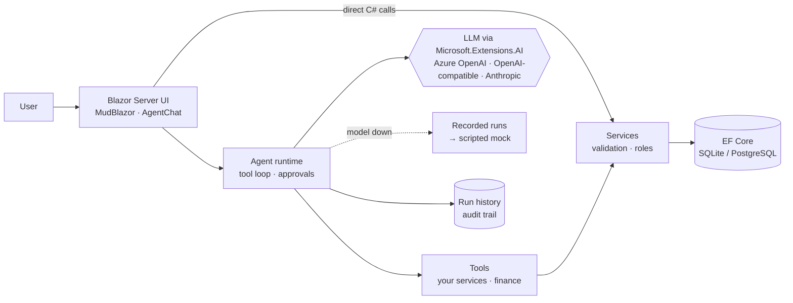

# Hackathon Starter (.NET): the template CRS Sentinel is built on

> Reference for the team's template, written before the hackathon (commit `381d8c2` in the git history). The product
> itself is described in the [README](../README.md) and [`PLAN.md`](PLAN.md). Kept in English, as written.

A generic app skeleton for AI-agent hackathons, in **C# only**: .NET 10 · Blazor Server · MudBlazor ·
EF Core · Microsoft.Extensions.AI. Clone it, rename it, and spend the hackathon on your idea, not on boilerplate.

- **Works with zero config.** SQLite file database, demo users, agents fall back to recorded runs or scripted mocks.
- **One language, no API layer.** Blazor Server components call C# services directly; the UI updates live over SignalR.
- **Agents built in.** Tool-calling loop, live step timeline, human approval, multi-agent panels, PDF reading, run history.
- **Finance module.** Tested loan / savings / retirement / IBAN functions, used by the UI *and* as agent tools.
- **Any model.** Azure OpenAI, OpenAI-compatible (OpenAI, Featherless, Groq, local Ollama) or Anthropic. Models without tool calling use a JSON fallback.
- **Can't die on stage.** Live model → recorded run → scripted mock.
- **Private at rest.** Run history, recordings and exports are saved with personal data masked ([CNP-1]).
- **Deterministic checks.** Verdicts computed by code (personal data leaks, compliance phrases, numbers vs the calculator), same input → same verdict.
- **Exports with approval.** A run becomes a regression test (xUnit / JSON) or a report; a person approves it first.
- **Synthetic data.** Valid CNPs, IBANs, cards, CUIs for demos and tests, deterministic per seed.

## Quick start

Install the [.NET 10 SDK](https://dotnet.microsoft.com/download), then:

```bash
dotnet run --project src/HackathonStarter
```

Open http://localhost:5000. Or open `HackathonStarter.slnx` in Visual Studio 2022 (17.14+) / VS 2026 / Rider and press F5.
For hot reload while coding: `dotnet watch --project src/HackathonStarter`.

Try **Assistant** (tools, approvals, PDF upload, loan maths), **Agent Arena** (multi-agent debate) and **Calculators**.

## First 30 minutes of a hackathon

1. **`Config/SiteConfig.cs`**: name, logo, colors, landing copy, navigation, demo users.
2. **Entities:** `dotnet run --project tools/NewFeature -- Invoice` → edit `Features/Invoices/Invoice.cs` and `InvoiceSeed.cs`.
3. **Agent:** copy `Features/Assistant/AssistantAgent.cs`, write tools that call your services, register it in
   `Program.cs`, put `<AgentChat AgentName="your-agent" />` on a page.
4. **Model:** copy `src/HackathonStarter/appsettings.Local.example.json` to `appsettings.Local.json` (git-ignored) and keep one AI block.
5. **Deploy** in the first hour ([`DEPLOY.md`](DEPLOY.md)): then every push to `main` is live.

AI coding assistants: conventions are in [`AGENTS.md`](../AGENTS.md).

## Architecture



The in-app **/architecture** page shows the same flow with the live list of agents and tools (for the video).

## Project structure

```
src/HackathonStarter/
├── Config/SiteConfig.cs        edit first: name, colors, landing, nav, demo users
├── Features/
│   ├── Items/                  example CRUD feature (entity, service, seed): copy it or use tools/NewFeature
│   ├── Finance/                FinanceCalculator (loan, savings, retirement), Iban: tested
│   ├── Assistant/              example tool agent
│   └── Arena/                  example multi-agent panel
├── Agents/                     agent runtime: model, runner (native/JSON/mock/panel), recordings, run store
├── Services/                   AI provider + StructuredAi, demo auth, PDF/text extraction, formatting
├── Data/AppDbContext.cs        EF Core (SQLite default, PostgreSQL optional), seeding
├── Components/
│   ├── Pages/                  dashboard, items, calculators, assistant, arena, runs, architecture, settings
│   ├── Agent/                  AgentChat, AgentTrace, SourceBadge
│   ├── Common/                 PageHeader, EmptyState, ErrorState, StatCard, Markdown, ConfirmAsync
│   └── Layout/                 app shell, nav, user menu, theme
└── Recordings/                 recorded agent runs (created by AI:Record), commit them
tests/HackathonStarter.Tests/   xUnit tests for the finance module
tools/NewFeature/               feature generator
```

## Agents

```csharp
public class SupportAgent : ToolAgent
{
    public override string Name => "support";
    public override string Label => "Support agent";
    public override string Description => "…";
    public override string SystemPrompt(ToolContext ctx) => "You are … Always use tools; never invent numbers.";

    public override IEnumerable<AgentTool> Tools(ToolContext ctx)
    {
        var orders = ctx.Services.GetRequiredService<OrderService>();
        yield return AgentTool.Create("findOrder", "Find an order by number.",
            async (string number) => await orders.FindAsync(number));
        yield return AgentTool.Create("refund", "Refund an order. Requires human approval.",
            async (int orderId, decimal amount) => await orders.RefundAsync(orderId, amount),
            needsApproval: true,
            summarize: a => $"Refund {a["amount"]} EUR on order {a["orderId"]}");
    }

    public override Task MockAsync(MockContext m) => m.SayAsync("…"); // scripted plan for no-model demos
}
```

Register with `builder.Services.AddSingleton<AgentDefinition, SupportAgent>();` and use `<AgentChat AgentName="support" />`.
The C# parameters become the JSON schema the model sees: use clear names and `[Description]`.

- **Human in the loop:** `needsApproval: true` → the agent only proposes; an admin/member approves in the chat, then the tool runs.
- **Record / replay:** rehearse with a real model and `"AI": { "Record": true }` (Development). Runs are saved to
  `Recordings/<agent>.json`: commit them. On stage, if the model fails, the closest recording is replayed;
  `"AgentMode": "Replay"` forces it (no Wi-Fi). Replay does not run the tools (only a replayed approval runs,
  with the recording's masked arguments), so film or demo data-changing steps live or on the mock and keep recordings for
  read-only questions.
- **Any model:** `"ToolMode": "Auto"` uses native tool calling and falls back to a JSON protocol if the model rejects tools.
- **Safe fallbacks:** a recording is replayed only for a similar question (`AI:ReplayMinSimilarity`), otherwise the scripted
  mock runs with the real tools. The chat says why it fell back and which recorded question it replayed.
- **Background runs:** runs don't depend on the browser tab. The conversation id is in the URL (`?c=…`): reload, lose Wi-Fi or
  share the link and the conversation (and a run still in progress) comes back. **Stop** cancels a run (status *Cancelled*).
- **Privacy:** with `AI:MaskPii` (default on) emails, IBANs, cards, CNPs and phone numbers are replaced with `[IBAN_1]`-style
  placeholders before anything is sent to the model, and restored in the answer and in tool arguments. The trace shows how many.
- **Big documents:** `searchDocuments` finds the relevant passages; `readDocument` returns at most 6,000 characters.
  The chat history sent to the model is trimmed to `AI:MaxHistoryChars`.
- **Cost:** tokens are stored per run; set `AI:InputPricePerMillion` / `AI:OutputPricePerMillion` to see an estimated cost.
- **Privacy at rest:** what is saved (run history, `Recordings/`, exports) is masked one-way: `[IBAN-1]` placeholders that are
  never restored. The arguments of an action awaiting approval are kept encrypted (ASP.NET Core Data Protection) until it is
  decided. `Privacy:RedactRecordings = false` keeps recordings readable (only with synthetic data).
- **Model profiles:** different models per role, e.g. an attacker on your own GPU server and a judge on another provider:
  `AI:Profiles:<name>` (unset fields inherit). Use with `ModelProfile` on an agent or `Profile` on a panel participant.
  A profile that isn't configured falls back to the main model.

## Deterministic checks, exports, synthetic data

- **Checks** (`Features/Checks`): plain C# rules, no model, so the same answer always gets the same verdict and a fingerprint.
  Built in: `pii-leak` (personal data not present in the request), `no-guaranteed-returns`, `no-personal-investment-advice`,
  `expected-number` (the answer must contain the value your calculator computed). Add phrase rules in `Checks:PhraseRules`
  without recompiling, or a class deriving from `Check`. An agent lists its checks in `Checks`; they run after every run
  (live, replay or mock) and show at the end of the timeline. HTTP: `GET /api/checks`, `POST /api/checks/evaluate`.
- **Exports** (`Features/Exports`, page **/exports**, button on every run): a run becomes a JSON test case, an xUnit test that
  replays the request against the API and asserts the checks, or a Markdown report. Exports start as drafts; only approved
  ones can be downloaded (`GET /api/exports?status=Approved` for CI). Add a format with an `IRunExporter`.
- **External targets** (`Features/Targets`, section `Targets`): a chatbot under test, a partner API or a model on your own
  server, by name. Kinds: `OpenAI` (any OpenAI-compatible endpoint), `Http` (any JSON API: `RequestTemplate` with
  `{{message}}` / `{{messages}}`, `ResponsePath` like `choices.0.message.content`) and `Agent` (an agent of this app: the
  built-in `assistant` target works with zero config). Answers are recorded (masked) and replayed when the target is down.
  HTTP: `GET /api/targets`, `POST /api/targets/{name}`.
- **Scenarios** (`ScenarioAgent`, page **/scenarios**): a driver model (profile `driver`) plays a customer, tester or attacker
  against a target for several turns; `StopOn` checks run on every answer and end the conversation at the first failure.
  Only the target's answers are judged. Without a model the driver plays its scripted `MockTurns`.
- **Data and privacy** (page **/privacy**): what reaches which model (and whether it runs on your infrastructure), what is
  stored and for how long, read from the live configuration. Runs older than `Privacy:RetentionDays` (default 30, 0 = keep)
  are deleted automatically every hour.
- **Synthetic data** (`Features/Synthetic/SyntheticData.cs`): people and companies with valid CNP, IBAN, card (test prefix
  400000), CUI, phone and `example.com` email. Same seed → same data. HTTP: `GET /api/synthetic/people?count=10&seed=42`,
  `/api/synthetic/companies`. Valid identifiers can coincide with real people's: never present them as someone's data.

## Phone, desktop and other clients

- **Installable app (PWA):** on a phone or laptop the web app installs with its own icon and window (Install app
  button / Share → Add to Home Screen). Phones get a bottom navigation bar (`SiteConfig.MobileNav`).
- **Photos:** the chat's attach (paperclip) button accepts images; on a phone it offers the camera. Vision-capable models read them.
- **Separate frontend** (Lovable, React, a mobile web app): call the API below from another origin with
  `Security:AllowedOrigins`. Ready-to-paste JS, a Lovable prompt and the native-app option: [`CLIENTS.md`](CLIENTS.md).

## HTTP API

Every agent is also an API (for a mobile app, a webhook, Postman, or another agent). Interactive docs: **`/api-docs`**.

| Endpoint | What |
| --- | --- |
| `GET /api/agents` | Registered agents |
| `POST /api/agents/{name}` `{ "messages": [{ "role": "user", "content": "…" }] }` | Runs the agent; streams NDJSON events (`step`, `delta`, `text`, …, `done`). `?stream=false` returns one JSON `{ answer, pendingApprovals, run }` |
| `GET /api/runs`, `GET /api/runs/{id}` | Run history / one run with all steps |
| `POST /api/runs/{id}/approvals/{approvalId}` `{ "approved": true }` | Approve or reject a proposed action |

Auth: the browser cookie, or header `X-Api-Key: <Security:ApiKey>` (acts as user `Security:ApiUser`).

## Configuration (all optional)

`appsettings.json` → `appsettings.Local.json` (git-ignored, for secrets) → environment variables (`AI__ApiKey=...`).
Ready-made blocks for Anthropic, Featherless, OpenAI, Azure OpenAI and Ollama are in `appsettings.Local.example.json`.

| Setting | Effect |
| --- | --- |
| `AI:Provider` | `None` (default), `Anthropic`, `OpenAI` (any OpenAI-compatible endpoint), `AzureOpenAI` |
| `AI:Model`, `AI:ApiKey`, `AI:Endpoint` | Model id (or Azure deployment), key, base URL |
| `AI:StructuredOutputs` | `true` if the endpoint enforces JSON schemas (OpenAI, Azure OpenAI) |
| `AI:ToolMode` / `AI:AgentMode` / `AI:Record` | See Agents above |
| `Database:Provider` | `Sqlite` (default) or `Postgres` + `ConnectionStrings:Default` |
| `Database:RecreateOnStartup` | `true` in Development: schema + demo data recreated on every start (no migrations). `false` in the Docker image: data survives restarts (admins can still use **Settings → Reset demo data**) |
| `AI:MaskPii`, `AI:ToolTimeoutSeconds`, `AI:ReplayMinSimilarity`, `AI:MaxHistoryChars` | Privacy masking, tool timeout (15 s), replay threshold (0.5), history limit |
| `AI:Profiles:<name>:Provider/Model/ApiKey/Endpoint` | Model per role (attacker, judge…); unset fields inherit from `AI` |
| `Privacy:RedactRecordings` | `true` (default): personal data masked in `Recordings/*.json` |
| `Privacy:RetentionDays` | Agent runs older than this are deleted automatically (default 30; 0 = keep forever) |
| `Targets:<name>:Kind/Endpoint/Model/ApiKey/…` | External systems (see above); `assistant` (built-in agent) is configured by default |
| `Checks:PhraseRules` | Extra phrase rules (`Id`, `Title`, `Mode`: `MustNotContain`/`MustContain`, `Phrases`) |
| `Security:AccessCode` | If set, visitors must enter this code once (cookie). Use it on the public URL once a real key is configured |
| `Security:ApiKey` | Enables `X-Api-Key` access to `/api` |
| `Security:AllowedOrigins` | Other sites allowed to call `/api` from the browser (CORS), comma-separated. Empty = none |
| `Security:AgentRunsPerMinute`, `Security:DailyLiveRunBudget` | Limits live model calls per user / per day; over the limit, agents fall back to replay/mock instead of spending credits |

The **Settings** page shows what is connected right now.

## Demo users instead of login

Real ASP.NET Core cookie auth with roles, but signing in is one click (app bar menu). Roles are checked in services
(`CurrentUser.Require(Roles.Admin)`) and work with `[Authorize(Roles = ...)]` / `<AuthorizeView>`.
Viewers can't edit or approve. Need real auth? Replace the `/switch-user` endpoint in `Services/DemoAuth.cs`.

## Commands

| Command | What |
| --- | --- |
| `dotnet run --project src/HackathonStarter` | Run (http://localhost:5000) |
| `dotnet watch --project src/HackathonStarter` | Run with hot reload |
| `dotnet build` | Build everything (must be 0 warnings) |
| `dotnet test tests/HackathonStarter.Tests` | Unit tests: agent runtime with a scripted fake model, finance, PII masking, search (~5 s) |
| `pwsh tests/HackathonStarter.E2E/bin/Debug/net10.0/playwright.ps1 install chromium` | Once: browser for the E2E tests |
| `dotnet test tests/HackathonStarter.E2E` | E2E: starts the real app and clicks through it in Chromium (~25 s) |
| `dotnet run --project tools/NewFeature -- <Name> [Plural]` | Scaffold a feature from Items |
| `docker build -t app . && docker run -p 8080:8080 app` | Production container |

## Deploy

Blazor Server needs a host that runs a .NET server (Vercel/Netlify won't work). Ready-made setups, step by step in
[`DEPLOY.md`](DEPLOY.md):

- **Render** (recommended for the hackathon): `render.yaml` + `Dockerfile`, free, ~5 minutes, auto-deploy on every push to `main`.
- **Azure App Service**: GitHub Action `.github/workflows/deploy-azure.yml` (free with Azure for Students).

CI (`.github/workflows/ci.yml`) builds with warnings-as-errors and runs the unit and E2E tests on every push.
`.github/workflows/keep-awake.yml` pings `/health` so a free Render instance doesn't sleep (uncomment its schedule on hackathon day).
Set secrets as environment variables in the host (`AI__Provider`, `AI__ApiKey`, …), never in the repo.
